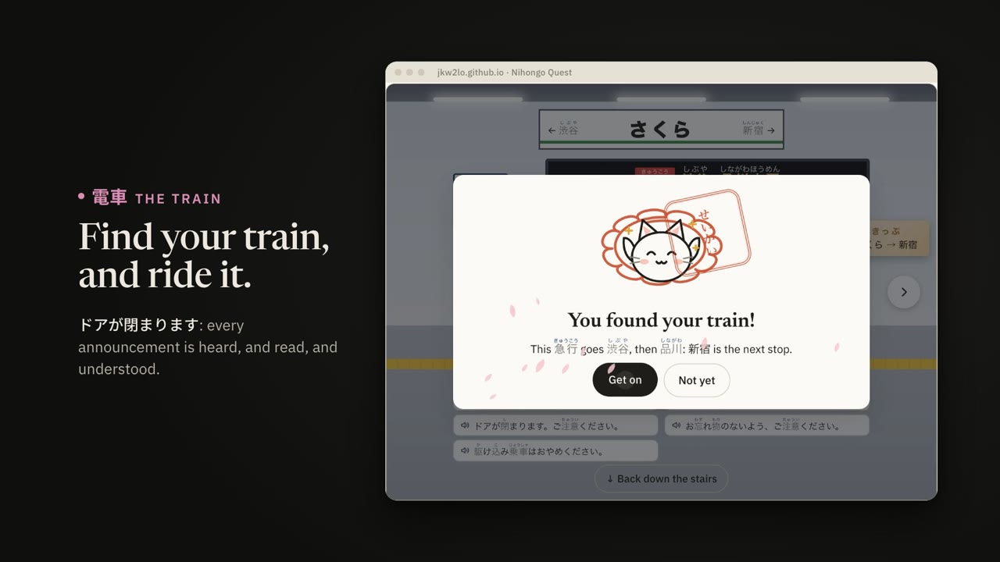

# Nihongo Quest

A practice notebook for getting by in Japanese: reading hiragana and katakana,
reading the signs, menus and short messages you would actually meet, and
holding a simple conversation. It starts from nothing and runs to JLPT N5,
then on towards N4. Writing is there if you want it and never in the way if
you don't.

> **Status: all of N5 is built (0.13.0).** The kana stage, then 1,127 words
> in nine stages (phrases, numbers and money, me and you, food, getting
> around, shopping, daily life, the て-form, and an N5 wrap-up), 40 grammar
> patterns, 161 kanji (all 103 of N5, and 58 N4) taught through the words, verbs and
> adjectives conjugated, a Grammar reference tab, flashcards, Out and about
> (menus, station signs and announcements, shop, door and road signs, a
> receipt, shop talk, asking for things and the way, casual Japanese,
> compliments), a 練習帳 Notebook for free writing, Sprint, Record with milestones, and optional sync across
> devices through Firebase.

**Live at:** https://jkw2lo.github.io/learn_japanese_nihongo_quest/
**Trailer:** https://jkw2lo.github.io/learn_japanese_nihongo_quest/trailer.html
(a minute and a half of the app, for anyone who'd rather watch than learn kana first)
**At a glance:** https://jkw2lo.github.io/learn_japanese_nihongo_quest/overview.html
(everything in it and how it's built, on one page, which prints on one sheet)

[](https://jkw2lo.github.io/learn_japanese_nihongo_quest/trailer.html)
**Repo:** https://github.com/jkw2lo/learn_japanese_nihongo_quest (`main`, over
SSH). GitHub Pages serves `main` directly: there's no build step and no CI,
so pushing is deploying. Bump the version on every push (see **Shipping a
change**), then check **Settings → Version** on the live site.

---

## What "getting by" means

It's worth pinning down, because it decides what gets left out.

**In scope**
- Read all of hiragana and katakana fluently, not just recognise them slowly.
- Read everyday things: a menu, a station sign, a price, a shop's opening
  hours, a short text message. That means the ~100 N5 kanji in the words they
  actually appear in, and a good part of N4's ~200 more.
- Say and understand survival phrases, then build simple sentences of your
  own: introduce yourself, order, ask the way, ask the price, talk about
  yesterday and tomorrow.
- Hear it. Every word and every sentence in the app can be played.
- Polite speech (です / ます) first, because it's what a visitor says to
  strangers. Plain forms come later, mostly so you can recognise them.

**Out of scope, deliberately**
- Keigo beyond set phrases (いらっしゃいませ gets explained, not drilled).
- Pitch accent as a drilled skill. It can be shown, but getting it wrong
  won't stop anyone understanding you, and drilling it costs a lot of time.
- Writing kanji from memory is **opt-in**. Writing kana is a real stage,
  because it's the fastest way to stop mixing up シ and ツ.
- Formal grammar vocabulary. A pattern is taught through the sentences
  it makes, and the grammar terms are only a note underneath.

---

## The unit you learn is the word

Hanzi Quest is built around one character per entry, and it works there
because in Chinese a character is a syllable with a meaning. None of that
holds in Japanese:

- A kana has a sound and no meaning. You learn it once and then use it.
- A kanji's sound depends on the word it's in. 生 is read せい in 学生, う in
  生まれる and なま in 生ビール. Learning 生 on its own gives you a list of
  readings to guess from.
- Most of what you need to get by is written wholly or partly in kana anyway:
  です, ありがとう, コーヒー, the endings on every verb.

So there are four kinds of thing to learn, and **the word sits in the middle**:

| | what it is | how many (to N4) | how it's learned |
|---|---|---|---|
| **かな Kana** | 46 + 46 base glyphs, plus voiced (が) and combined (きゃ) forms | ~210 | sound ↔ shape, fast, until automatic; then done |
| **言葉 Words** | vocabulary, each with its kana spelling and usual written form | ~1,500 | the scheduled core, like characters in Hanzi Quest |
| **漢字 Kanji** | a character learned through words you already know | ~300 | a step up from a word, never taught before one |
| **文型 Patterns** | grammar: 〜は〜です, 〜てください, 〜たことがある | ~150 | through example sentences made only of words you know |

The ordering rule that follows from this: **kana first, then words in kana,
then kanji as an upgrade to words you already have.** You learn たべる as a
word you can say and hear. Later 食 shows up as the way it's usually written,
with 食べ物 and 食堂 as the payoff. You never meet a kanji before a word that
uses it.

---

## Stages

A teaching order, as in Hanzi Quest: each stage should make the next one
easier. The contents will change, but the shape shouldn't.

| # | Stage | What unlocks |
|---|---|---|
| 0 | **ひらがな Hiragana**: vowels → k s t n → h m y r w → ん → voiced (が ぱ) → combined (きゃ) → small っ and long vowels | the hiragana check |
| — | **The hiragana check**: two separate days of proving it stuck (see below) | katakana |
| 1 | **カタカナ Katakana**, same order, then the loanword sounds (ティ, ファ) | **the Menu side quest** |
| 2 | **あいさつ Survival phrases**: hello, thanks, sorry, excuse me, please, I don't understand. All in kana, learned as whole chunks | |
| 3 | **数 Numbers, time, money**: いち→まん, 〜時, 〜円, いくらですか | prices on the menu |
| 4 | **私 Me and you**: は〜です, の, questions with か, この/その/あの | |
| 5 | **食べる Food and ordering**: を, 〜をください, 〜がいいです, the first verbs in ます form | first kanji: 日 月 人 口 |
| 6 | **行く Getting around**: に/へ/で, 〜はどこですか, directions, stations | 駅 出口 入口 on signs |
| 7 | **買う Shopping**: adjectives (い/な), これ/それ/あれ, 〜はありますか | |
| 8 | **毎日 Daily life**: time words, ます-form past and negative, frequency | |
| 9 | **て-form**: 〜てください, 〜ています, 〜てもいいですか | the second big grammar step |
| 10 | **N5 wrap-up**: plain forms (for recognition), 〜たい, 〜ましょう | tier 2 |
| 11+ | **N4 topics**: 〜たことがある, 〜と思う, potential, 〜たら/〜ば, giving and receiving | |

Stages 0–1 work differently from everything after them. See **Kana** below.

### Tiers

As in Hanzi Quest (*Tiers — the gates on the library*), tiers are doors
across the teaching order, set at points that mean something:

- **Tier 1 · Kana**: stages 0–1.
- **Tier 2 · N5**: stages 2–10.
- **Tier 3 · N4**: stages 11 on.

A tier opens at `TIER_UNLOCK` (80%) of the one before it. Placement credits
past the gate, and the unlock is worked out from what you know, so proving
you can read kana opens N5 without any special case. Locked stages collapse
to one card saying what opens them, rather than hundreds of grey squares.

---

## Kana

Kana is a set list you get through. It isn't a library you live in, so it
gets its own flow and doesn't go into the review queue:

- **Five a day, a row at a time.** A lesson is one row (か き く け こ),
  learned together, because the row is what makes the pattern visible. No
  lesson is bigger than five: the voiced sounds are a row each, and the
  combined sounds are three-kana rows (きゃ きゅ きょ). A day's allowance is
  counted in kana (Settings → New kana a day, 5 by default, up to 20).
  Rows are never split, with one kana of slack so two three-kana rows can
  share a day. At five a day, hiragana takes 21 days and katakana about the
  same again.
- **Meet it, hear it, trace it.** Each new kana gets a card (the glyph, its
  sound, a picture story), then a tracing step with the shape faint in the
  box, and then reading and listening questions. Writing it from memory is
  one of the day's practice tasks. See **Writing**.
- **Mnemonics are optional.** Each glyph has a short picture story (`story`,
  as in Hanzi Quest), shown on the first meeting and on a miss, and hidden
  otherwise.
- **Look-alikes are taught on purpose.** シ/ツ, ソ/ン, ぬ/め, わ/れ/ね, る/ろ,
  and は vs ほ. Each pair has a side-by-side card and its own drill, dealt
  after both halves are known. Hanzi Quest's 辨形 Spot-it mode, which deals
  look-alikes first, is the model.
- **Speed is the goal, and it's measured.** A glyph counts as known when it's
  recognised correctly *and* quickly, several times over. Being right slowly
  isn't enough, because reading slowly is still slow reading. This is where
  Sprint earns its place from day one.
- **Kana leave the queue once words are open.** A kana that's solid in
  reading and hearing (three quick passes each) stops being scheduled on its
  own, and the words you read keep it fresh instead. One that isn't solid
  yet keeps coming up. (Still to do: dropping a review onto the kana behind a
  missed word.)
- **っ, ッ and ー are drilled by ear.** They have no sound of their own, so
  their lessons are an explanation card plus word pairs: hear きって or きて,
  pick the spelling (`KANA_PAIRS_WORDS`). びょういん (hospital) against
  びよういん (hair salon) is in there too, because it's a real trap.
- **Katakana through loanwords.** You learn コ, ー and ヒ, and the reward is
  コーヒー straight away. Guessing the English word is the fun bit (パソコン,
  アイスクリーム, コンビニ), and it's how katakana actually turns up in real life.
- **Real words from the first day.** `KANA_WORDS` is ~190 words spelled only in
  kana. A word shows up in *Words you can read* the moment every kana in it
  is learned — いえ (house) after the first row. Katakana words are mostly
  loanwords, so reading one is guessing the English, which is the fun part.
- **Words are part of every kana lesson, not just Go deeper.** A lesson
  ends with *Now you can read*: up to six words its kana have just made
  readable (`SPELL_MAX`), as tiles side by side, each taken apart
  (い i + え e = いえ ie, house), each kana tappable — then every one of
  them read in a question, so none is left to find on the Words tab. Words already sounded out in an earlier lesson come last
  (`state.spelled`). Today's practice on a kana day adds 言葉 *Read the
  words they spell*.
- **Why あい is spelled あい: it isn't, beyond its sound.** Kana are letters.
  Nothing in あ or い means love, any more than c, a and t mean cat. The
  first *Now you can read* card says so, and so does the introduction's
  hiragana card. Two things help instead (`KANA_WORD_EXTRA`): `kj`, the
  kanji a native word is usually written in, shown small as the place its
  meaning actually lives (あい → 愛), and `hook`, a sound-alike to tie sound
  to meaning (ねこ: a cat curled round your neck), only where there's a
  good one.

### Hiragana and katakana side by side (0.35.0)

The Kana tab's chart has a fourth view, **あ⇄ア**: the hiragana chart with
each kana's katakana beside it in the same square (hiragana in its blue,
katakana in its pink, the romaji under them), each faded until it's
learned. Pairs that look alike — か/カ, き/キ, け/ケ, こ/コ, せ/セ, に/ニ, へ/ヘ,
も/モ, や/ヤ, り/リ and their voiced forms — carry a gold dot (`ALIKE`). A
tap opens the two big side by side, to hear and to open either one's own
card (strokes, words, standing). Katakana's own sounds — ー and the
loanword pairs (ティ, ファ, ウィ…) — have a card of their own. It's a
reference, so katakana not yet open can still be looked at, as the
katakana chart already allows.

### The introduction

A brand-new learner doesn't know Japanese has three scripts, never mind why
a chart of kana looks the way it does. So before the very first lesson,
seven short cards (`js/guide.js`) explain:

1. **Three scripts, one sentence.** 私はコーヒーを飲みます, coloured by script:
   hiragana indigo, katakana plum, kanji ink.
2. **Hiragana**: the core sounds, used for grammar and words without kanji.
3. **Katakana**: the same sounds, for borrowed words, names and emphasis.
4. **Kanji**: characters with meanings, met later through words, with
   furigana until then.
5. **How the chart is laid out**: a consonant plus a vowel; vowels across,
   consonants down; a row shares a consonant, a column shares a vowel.
6. **Why that order**: it's Japanese alphabetical order (五十音, "the fifty
   sounds"), usually traced to Sanskrit phonetics. Vowels first, then
   consonants from the back of the mouth to the lips (h was once p); the
   gaps are sounds modern Japanese lacks.
7. **How this goes**: five a day, the check, then katakana, and romaji only
   while learning.

It can be read again from **Settings → Japanese writing**, and the Kana tab
opens with a short **How this chart works** card, open by default until ten
kana are learned. The first lesson of each new kind opens with its own card
(`KIND_INTRO`): the voiced marks ゛ and ゜, small ゃ ゅ ょ, katakana itself,
and the loanword sounds.

### The hiragana check

Katakana doesn't open when the last hiragana is learned. Hiragana has to be
**cemented** first, and the evidence for that is time:

- From the day *after* the last hiragana is learned, a **check** is offered:
  every hiragana once to read, the twenty shakiest to hear, four pause pairs
  and eight real words, about 136 questions and six or seven minutes.
- It passes at **90% right first time** (`HIRA_CHECK.pass`). Misses come back
  at the end of the check for practice, but only first tries count.
- It has to pass on **two separate days** (`HIRA_CHECK.days`). Two passes on
  one day count once. The day hiragana finished never counts, so there is
  always at least one night's sleep in between.
- There's no limit on tries. A failed try shows the best score so far.
- It's graded "auto": anything due for review is reviewed by the check, so
  check days don't also carry a separate review pile.
- Once katakana opens it stays open (`state.kataOpen`), even if the rules change.

On the day the last hiragana is learned, Today says the check starts
tomorrow and suggests Go deeper or a hiragana sprint instead. It doesn't
offer a check that couldn't count.

### Romaji

Romaji is **hidden by default** and switched on in **Settings → Show romaji**.
It's hidden so your eyes learn to read the kana, not the letters under
them. Kana lessons always show it, because that's what they teach, and so do
a question's answers and verdicts. The setting governs everything else: the
word lists, the romaji under each kana on the chart, and word cards.

The chart's **axes** are always labelled, whatever the setting: a i u e o
across the top, and the consonant at the start of each row (k, s, t… and
ky, sh, ch… for the combined sounds). They're how the chart is read, and a
new learner needs them most.

---

## Words

The scheduled core, from stage 2. Each word (`js/data/words.js`) has a
written form in furigana markup, a meaning, a part of speech, a stage, often
a note, and example sentences for many.

- **Words open when every kana is learned.** README's tiers open at 80%,
  but the kana stage is gated the whole way through (hiragana cemented
  before katakana), so words wait for the last kana too.
- **Five a day**, under the same **New kana a day** allowance, which counts
  words once kana are done. There are 1,127 words in nine stages and 83
  topics (0.52.0): a stage's lessons go topic by topic — numbers, then
  counting, then money; family, then jobs — and a topic of more than five
  is split evenly (sixteen numbers are four lessons of four), so a lesson
  is never a mix. Each is titled by its topic (数字 2, *Numbers 2*), and the
  Words tab lists what you know topic by topic. A few everyday words not on
  the N5 list round out thin topics — five fruits, six vegetables, six
  animals — and 247 more are the everyday ones N5 leaves out (0.54.0):
  futon and tatami, cash and change, temple and shrine, neck and finger,
  typhoon and earthquake, find, drop, break, fix, laugh, cry, smartphone,
  charger, Wi-Fi. All are marked *beyond N5* (`x`). The stages:
  - **2 · あいさつ** survival phrases (30)
  - **3 · 数** numbers, time and money (110): counting, the clock, the days
    of the week, months and dates (the irregular ついたち to とおか, and
    はつか)
  - **4 · 私** me and you (127): this and that, question words, family (my
    父 and your お父さん), jobs, countries, age and birthdays
  - **5 · 食べる** food and ordering (130): dishes, drinks, tableware,
    hot and cold, eating in or taking away, counting to ここのつ
  - **6 · 行く** getting around (140): trains, platforms and lines, places
    in town, on/under/behind/next to, the compass, sixteen verbs, and the
    particles に, で and へ
  - **7 · 買う** shopping (161): い- and な-adjectives, colours, ある and いる;
    clothes and the verb each one takes, stationery, shops, counters for
    flat and small things
  - **8 · 毎日** daily life (166): everyday verbs, how often, と, から, まで;
    the home, chores, school and free time, もう and まだ
  - **9 · て形** the て-form (92): the verbs you ask people to do —
    show, send, switch on and off, push and pull, take your shoes off —
    and the phrases of coming and going (いってきます, ただいま)
  - **10 · まとめ** wrapping up N5 (171): weather and seasons, feelings,
    health and the body, nature and animals, でも・だから・それから, and
    casual うん, ううん and またね

  Each stage opens with a card saying what it's for. The very first word
  lesson opens with one explaining furigana.
- **Meet it, then three drills.** A word card shows the word with furigana,
  its meaning, a note and any examples, all tappable to hear. Then:
  - `r` **read it**: see the word, pick the meaning
  - `p` **hear it**: hear it, pick the word
  - `c` **type it**: see the meaning, type it in romaji. It turns into kana
    as you type (`romajiToKana`), the way a Japanese keyboard does. Kanji
    conversion is left out on purpose: typing the kana spelling proves you
    know the word.

  Each is a separate skill, as in Hanzi Quest: you'll recognise 大丈夫 long
  before you can produce it. Today's practice for a word day is 学ぶ, 読む,
  聞く and 打つ; Go deeper gets three word tiles.
- **Typing is marked kindly.** It's right if the kana say the same thing
  (`kanaSame`). Script doesn't matter, so typing コーヒー as koohii is fine,
  and nor do ー against a doubled vowel or おお against おう. It's also right
  if the romaji matches the word's own, so こんにちは can be typed
  konnichiwa. **Hint** shows the first kana and the length, and turns the
  answer into practice, not credit.
- **Stored apart from kana.** Word items live in `state.words`, keyed
  `w:` + the written form, so nothing that walks the kana ever meets a word.
  They go through the same `grade()` and `dueKeys()`.
- **Spoken from kana.** Every word and example is recorded from its kana
  (`js/audio-s2.js` … `audio-s10.js`, one per stage), so the voice never guesses
  a kanji's reading. A word can set `say` where its spelling misleads: the
  particle は is said わ.

Verbs and adjectives get a fourth skill, `j` **conjugate it**: see the
word and a form, and type the form. The forms drilled grow as you go: the
four polite ones from the start (〜ます… or 〜いです, 〜くないです…), the
て-form once 〜てください is learned, and the casual た and ない forms after
stage 10's casual-forms pattern. A verb's card shows its four polite forms, each tappable.
Every form is generated (`js/conj.js`), never typed into the data. See
**Conjugation**.

`s` (say it aloud and mark yourself) and `w` (write kanji) aren't built. See
**Open questions** and **Kanji**.

### Conjugation

`conj(markup, pos, form)` works a form out from the dictionary form and the
verb's class, and returns markup, so the result renders with furigana like
any word. The classes are:

- `v1` (ichidan)
- `v5` + the last kana (godan: `v5u` `v5k` `v5g` `v5s` `v5t` `v5n` `v5b` `v5m` `v5r`)
- `v5k-s` (行く, whose て-form is 行って)
- `vs` (する, and noun + する)
- `vk` (来る, whose kanji reading changes: 来ます is きます, 来ない is こない)

The forms are ます, ません, ました, ませんでした, て, た and ない. Only the four
polite ones are taught so far (`CONJ_TAUGHT`), because they're what a
visitor says. The smoke test pins every form of a verb for each godan
ending and each exception, and runs every verb in the data through every
form.

Every taught form of every verb is recorded, so the forms on a verb's card
and the answers to a conjugation question can all be played.

### The Words library

The **Words** tab lists **every word you can read**. It only grows: nothing
drops off the end the way Today's short list does.

- **Learned words**, grouped by stage, each opening a card with its note,
  examples and how it's doing in each skill.
- **Spelled in kana**: every word in `KANA_WORDS` whose kana are all yours,
  newest first. There are ~190, and the first arrives with the first row.
- **Filters** (All, Learned, ひらがな, カタカナ) and a **search** across kana,
  romaji and English.
- **Coming up**: how many kana words are still out of reach, and which
  single kana would unlock the most of them.

Words are **tiles**, as many across as fit (two on a phone), not a line
each, so the list stays short as it grows. A word of six or seven kana is
set smaller; a phrase of eight or more (おはようございます) gets a
double-width tile so it reads in one line. Tapping a word **just says it**.
The › in its corner opens its card. Today's rail works the same way: it shows the newest, scrolling in
place, with a link to the whole list.

### Reading never outruns you, now with furigana

Hanzi Quest's rule is *never show a sentence with a character you haven't
met* (`readingMaterial()`). Japanese has a better tool for this, and real
children's books use it: **furigana**, small kana printed over a kanji.

When the app draws any Japanese text:

- A kanji you **know** is shown bare.
- A kanji you **don't know yet** gets furigana, so you can still read the
  word and start seeing the kanji before it's taught.
- A **word** you don't know yet is never in a drill sentence. Sentences for a
  drill are picked so that every word in them is known. That's the part of
  the Hanzi Quest rule that still applies.

So the same sentence gets lighter as you go. The menu uses the same rendering.
Settings has "always show furigana" and "never show furigana" for anyone who
wants them.

This depends on how readings are stored. See **Furigana markup** under Data.

---

## Kanji

Kanji are a layer over words, never the way in. Built (`js/data/kanji.js`,
generated; `js/data/kanji-lessons.js`; `js/kanji-ui.js`).

- **Which kanji:** all 103 of N5, and 58 chosen from N4 — 161. Every N5
  kanji appears in the stage words (since 0.46.0), so each has a word to be
  taught through. KANJIDIC's `jlpt` field is the old four-level test, where
  4 ≈ N5 and 3 ≈ N4; the N4 ones taught are those with a meaning written in
  `tools/fetch-kanji.mjs`. The rest of N4 (曲, 渡, 洗…) and rarer ones (丈夫,
  全部, 卵, 昨…) keep their furigana.
- **Each is taught through a word you know.** A stage's kanji, the ones its
  words are first to use, get lessons of five placed after that stage's
  words and patterns, in the order those words are taught (so the numbers
  come out 一 二 三). The smoke test checks that every kanji has a word by
  its stage to be taught through. The first kanji lesson opens with a card
  on on and kun readings.
- **The card:** the kanji, its meaning, its readings (on in katakana, kun in
  hiragana with the okurigana in brackets: た(べる)), its strokes (tap to
  animate), and **the words you know that use it**, each tappable.
- **Once learned, its furigana goes, everywhere.** `knowsKanji()` is what
  `furiHtml()` asks, so words, sentences, patterns, the Words tab and the
  diner menu all drop the reading for a kanji you know. A run keeps its
  furigana until every kanji in it is known (今日 needs both).
- **Readings are shown, never drilled as a list.** Reciting "ショク, た.べる"
  helps nobody get by. There are two skills:
  - `m` **what it means**: pick from other kanji's meanings.
  - `y` **read it in a word**: a word you know, with this kanji's part of
    it bare and highlighted ("How is 高 read here?" → たか). The wrong
    answers are the kanji's own other readings first (こう), then other
    words' kanji readings of the same length that share the most kana.
    Asking about the kanji's part, not the whole word, means a set phrase
    can't give itself away by length.
- **Writing is opt-in**: Settings → Write kanji too, off by default. With it
  on, each new kanji gets a trace and Today gets a 書く task. The writing
  marker is the same as for kana; the stroke data is AnimCJK's
  `graphicsJa.txt`, and every kanji's stroke count matches KANJIDIC's
  (checked by the smoke test).
- **Where they show up:** Today's list on a kanji day (学ぶ, 意味, 読み, and
  書く if on), a 漢字 tile in Go deeper, rows in Record, and a **漢字 chart**
  as the third tab on the Kana page, grouped by stage, each opening its card.
- **Meanings are written for the app** (`KANJI_MEANING` in
  `tools/fetch-kanji.mjs`); KANJIDIC's first meanings read 行 as "going,
  journey, carry out". **Readings and stroke counts are KANJIDIC2's.**

---

## Patterns (grammar)

Chinese barely needed a grammar track; Japanese does. Built
(`js/data/patterns.js`, `js/patterns-ui.js`), with 40 patterns across
stages 3 to 10, the everyday structures N5 covers:

- **Stages 3–6:** は〜です, じゃないです, か, の, この/その/あの, も, が好きです,
  をください, を〜ます, ません/ました, に (going and time), で (by and at),
  はどこですか and に乗ります.
- **Stage 7:** はありますか, があります/います, な + noun, くないです,
  かったです and にします.
- **Stage 8:** と, から〜まで, あまり〜ません, ましょう and ませんか.
- **Stage 9:** てください, ています, てもいいですか, てから and ないでください.
- **Stage 10:** たいです, から (because), が (but), ね/よ, and the casual
  forms (for recognising).

A gap can carry its own choices per sentence, since a て-form question
offers 待って / 待った / 待ちます.

- **One pattern, one card**: the pattern, what it means, how it's built,
  and two or three example sentences, each tappable to hear.
- **Lessons come after the stage's words.** A stage's patterns get a lesson
  (four at most) placed right after its last word lesson, under the same
  daily allowance. Someone already past a stage meets its patterns next.
  The very first pattern lesson opens with a card on what particles are.
- **Examples only use what you know.** Every kanji in a pattern's examples
  must appear in a word from that stage or earlier, and the smoke test
  checks every one. Names are in katakana (スミスさん) for the same reason.
- **Two skills**, `f` and `r`:
  - **Fill the gap** (`f`). Each example marks its gap in the data
    (`{私|わたし}«は»{学生|がくせい}です。`), and the drill blanks it. For a
    particle, the wrong answers are the confusions people actually make
    first (は/が/も, に/で/へ, を/が), then others. For a form (ません/ました)
    or a word (この/これ), the pattern lists its own choices. The sentence
    can't be played until it's answered, because the sound gives the gap away.
  - **Understand it** (`r`): pick what a sentence means from other
    patterns' sentences.
- Patterns live in `state.patterns` (key `g:` + id) and go through the same
  scheduling as everything else. Today's list on a pattern day is 学ぶ,
  文型 fill the gaps and 文 understand them. Go deeper has a 文型 tile, and
  the **Grammar tab** lists every pattern.

### Teaching a pattern (all 40, built up from 0.34.0 to 0.39.0)

One card and two drills told you what a pattern was; it didn't teach it.
Now a pattern with a teaching entry (`PATTERN_TEACH` in
`js/data/patterns.js`) is walked through, three to a lesson:

1. **Hear it used.** A few lines of conversation where the pattern does
   its job — meeting someone, asking a price — A on the left and B on the
   right, each line tappable.
2. **How it's built.** One sentence cut into its parts, each with its job
   underneath and the pattern's own parts lit; the rule in a line. Each part
   plays when tapped.
3. **Don't mix it up**, where there's a classic mix-up: two sentences that
   differ only there, side by side, and what the difference does (は and が,
   は and も, この and これ, AのB either way round).
4. Its **examples**, as before.

Then two new drills beside fill-the-gap and understand-it:

- **Build it** (`o`): the English, and the sentence in pieces to tap into
  order — the first drill where you put Japanese together yourself, word
  order and particles both. A decoy or two (が where を is wrong, です where
  じゃないです is wanted) means it isn't only ordering. Enter checks,
  Backspace takes the last piece back, numbers pick from the tray.
- **Change it** (`t`): a sentence and a change to make — make it not,
  make it a question, say it's true of you too — and four sentences to
  choose from, three of them the near misses people make
  (これはペンないです). It can't be played until it's answered.

Both count towards the **fill** skill (`c.sk`), since both are producing
the pattern, so Today's tasks and reviews are as they were. Every sentence
in the teaching uses only words from its stage or before (and kana words),
names stay in katakana, and the smoke test checks every kanji, every
furigana run and the shape of every part; every sentence is recorded
(`patternSay`: the stage bundle for lessons, the grammar bundle for the
tab). The Grammar tab shows the same teaching inside each pattern.

### The Grammar tab

A reference to come back to (`js/data/grammar.js`, `js/grammar-ui.js`).
Every sentence on it plays: `js/audio-grammar.js` holds the tab's own
sentences and every pattern's examples, repeating what the stage bundles
have, because the tab shows every pattern from the start. (Until 0.33.0 it
left out anything a stage bundle had, and for anyone who hadn't reached
those stages the tab was nearly silent.)

- **How a sentence is built:** 私は 毎日 電車で 駅に 行きます, cut into its
  chunks (topic, when, how, where to, verb), with the points that matter.
  The verb comes last, particles come after what they mark, the middle
  order is loose, and obvious things get dropped.
- **Particles:** は が を に で へ の も と か ね よ, each with its job in one
  line and an example to hear.
- **Endings at a glance:** now / not / past / past-not for verbs, both
  kinds of adjective, and nouns.
- **Every pattern**, by stage. Learned ones open to their examples;
  upcoming ones are there to look ahead at, marked with the stage that
  teaches them. There's a button to practise the ones you know.

### 練習帳 The Notebook

A place to just write, lifted from Hanzi Quest's exercise book
(`js/book-ui.js`). It keeps the shape Hanzi Quest's phone version proved
out, on the desktop too. There's **one big box** to write a character in,
and **Add to page** (Enter) sets it in the next square of today's page and
wipes the box for the next one. You never zoom in on a page to fill one
square: the box stays big and the page fills itself.

- **Guides.** The squares' lines can be 十字 (a cross), 米字 (a star) or
  none. You can also pick a character to trace: hiragana, katakana or
  kanji, including ones not learned yet, which show faintly. It appears
  faintly in the box, copybook style, and its stroke order plays beside
  the box, with Again and Hear it.
- **Pens and nibs.** Pen, brush, pencil and marker; fine, medium and broad.
  The nib sets the width and the pen scales it, so a fine brush and a
  broad brush still differ. Each square keeps the pen it was written with.
- **Dated pages.** A page has 36 squares (6 × 6). When it's full, the next
  square starts a new page. You can also start a new page yourself, or
  take back the last square (it goes back into the box). Every page is
  kept under its date in **Your pages**, and any page can be opened again
  or deleted.
- **Keys:** Enter adds to the page; Z or Backspace undoes a stroke.
- **Storage.** Pages are vectors: each square's strokes in the same 1024
  box the writing drills use, so they redraw crisply and re-ink with the
  theme. They're kept in IndexedDB (`nihongo-quest-book`), outside the
  progress record, so they don't sync. They do go into the backup file
  (`pages`), and loading a backup that has them restores them. Characters
  written count towards the day's study time and are tallied per day
  (`days[d].bk`).

### Flashcards

The **Cards** tab (`js/cards-ui.js`): decks for today's items, hiragana,
katakana, words, kanji and patterns, built from what you've learned.
- Japanese → English or the other way round, shakiest first or shuffled.
- Look, think, flip (it turns over, and says the word), then **Again**,
  which sends the card to the back of the deck, or **Got it**.
- Keys: Space flips, 1 is Again, 2 is Got it, and the arrows move.
- On a phone the card fills the screen and the buttons sit at the bottom.
- It's self-paced, so like Go deeper it never moves a review, and a
  self-marked card isn't evidence for "solid".
- **Conjugations are generated in code**, never typed into the data. See
  **Conjugation** under Words.

Still to come: patterns for stages 7 and on (adjectives, the て-form and
more), and Sprint modes for conjugation and particles.

---

## Review days

A part-time learner forgets yesterday's row far more often than a full-time
one, so new lessons pause now and then (`reviewDay()` in `js/srs.js`):

- **After three days of new lessons in a row**, a day with none
  (Settings → Review days: every 4th day by default, 3rd, 5th or never).
- **After a break of three days or more**, whatever the rhythm.

A review day's session is what's due, then everything learned on the last
few learning days (`recentLearned()`): each once in its weaker skill, the
shakiest ten again in the other, and, in the kana stage, six of the words
those kana spell. Today's practice ticks against the same set. The hero says
why there's no lesson, and offers *Learn something new anyway*, which makes
the day a learning day again. Nothing is stored: it's worked out from the
days already recorded, counting days studied, not calendar days, so it
can't drift between devices.

## Today

The daily loop, lifted almost whole from Hanzi Quest (*The blocks on Today*,
*What the numbers count*, *Go deeper is not part of the list*).

1. **The invitation**: the session, and what you've picked up today.
2. **Today's practice**: a to-do list scoped to *today's* items, so it's
   short and can be finished:
   学ぶ learn · 読む read · 聞く listen · 話す say · 文型 today's pattern ·
   書く write (kana stages, or if opted in).
   A tick needs evidence: a task ticks when every one of today's items has
   been answered correctly in that task's drill. Each task declares which
   drill kinds prove it (`proves`). A task that can't be done yet shows a
   lock and a reason, and the count reads `2 of 4 done · 1 locked`. The locked
   task stays in the total rather than being dropped from it.
3. **Go deeper**: the same skills over everything you know, shakiest first,
   with rings that fill on every clean pass (`PASSES_FOR_SOLID` = 3). It's
   extra practice, so it can never make tomorrow's reviews worse: a right
   answer doesn't push the next review back, and a miss still brings one
   forward (`grade(..., {practice: true})`).
4. **Out and about**: the menus and the real-life scenes.

**Past the kana** (`wordsOpen`), Today changes shape a little (0.42.0):

- **今日の読み Today's read** sits right under the session: one reading
  activity, started in one tap — a short text not read yet if one's open,
  otherwise Subtitles or Phrases, turn about by the day. It ticks once a
  reading round is finished that day (`day().read`).
- **The kana chart moves** (`navOrder`) to the end of its group, Study —
  a reference now, no longer the second thing you want. The sections stay
  in their coloured groups (`NAV_GROUPS`, 0.56.0) either way.
  (The phone's wheel takes the order the first time it opens.)

Every number on Today counts items, never answers, for the reason Hanzi
Quest's *What the numbers count* gives.

---

## The side quest: Read a Menu

Hanzi Quest's menu teaches one character a day from a real restaurant menu,
with the glyphs you know inked in. It carries over well, because **Japanese
menus are mostly katakana**. Built (`js/data/menu.js`, `js/menu-ui.js`):

- **カフェ さくら**, a café, all katakana: 26 drinks, dishes and desserts.
  Each item inks itself in kana by kana as you learn them; kana you don't
  know yet stay grey, so you can watch it fill up. Tapping anything says it
  and shows what it is. It opens like every place (below): when half its
  items can be sounded out, which, with ー in most of them, is at the end of
  katakana.
- **食堂 まるや**, a diner, is the real thing: 定食 set meals, bowls,
  noodles, sides and drinks, with kanji dish names and furigana. It opens
  by the same rule, late in hiragana.
- **Ordering for a friend.** They say what they want in English, and you
  find it on the menu: three things, then the bill. A wrong tap tells you
  what you actually picked. The **receipt** shows each item, the total in
  yen, and, once the numbers stage is learned, the total **said in
  Japanese** (`numberKana`: 1250 → せんにひゃくごじゅう, with the sound changes
  a price meets). Then how you'd order each item: 〜をください.
- **Useful at the table**: すみません, 〜をください, お会計をおねがいします.
- It's practice: nothing here touches the review schedule. Orders are
  counted (`state.menu`), and Today shows them on the menu card.
- Each menu hangs a **noren**, the shop curtain over a Japanese doorway,
  drawn in SVG with the shop's name.
- The smoke test checks every item: sound markup, only taught kana,
  sensible prices, and a café that stays kana-only.

Still to do: the izakaya tier (本日のおすすめ).

### Out and about: the scenes

The Menu section grew into **街 Out and about**: the two menus and twelve
scenes of the Japanese you meet off the page (`js/data/scenes.js`,
`js/scenes-ui.js`). Recognition is the point. Stay at N5, but be able to
read the sign and catch the announcement.

**The landing page.** Out and about opens on a page saying what it's for,
how it works (learn kana → a place opens → look, listen, test yourself),
how many places are open with a track of them in order, and what opens
next and roughly which lesson brings it. Then every place as a tile: how
many of its words you can read, a bar with the halfway mark on it, and
whether it's open, with a *new* badge until an opened place is visited
(`state.outSeen`). A strip of places, with *All places* first, runs above
each place.

**When a place opens: half its words.** A place is open once you can
**sound out** half its words, meaning every kana in them is learned. Kanji
come with furigana, so kana is enough to sound them out. It counts words,
not characters, on purpose: five lessons in, about half the characters on
a station sign are yours, but not one whole word is. The places are shown
in the order they open if lessons go in order (`opensAt`, worked out from
the lesson list), so the page doubles as the road ahead. A place that isn't
open can still be looked round, listened to and tapped; only its quiz (and
the menus' ordering game) waits.

**The ink.** Everywhere in Out and about, each kana you know is dark and
each one you don't is grey (`inkHtml`), so a word fills in as you learn its
kana. A kanji you haven't learned stays grey: a softer grey when the kana
above it are all yours, since you can at least sound it out. A key under
each place's title says so.

**Levels: the same place, deeper.** Opening a place is the start. Each
has three levels, earned in any order (`placeLevels`), shown as three steps
under its title and as three dots on its tile:
1. **読 Sound it out**: every word, not just half.
2. **分 Know what it says**: most of it (80%) recognised, in a scene's quiz
   or, for a menu, by finding it in an order. Both are kept in
   `state.scenes`.
3. **字 Read it as written**: every kanji in it learned, so the furigana has
   gone. A place in kana alone is read as written already. The station
   has 47 kanji and the course teaches 13 of them, so this level is
   deliberately a long way off: it's where N4 would take you.

**A word from the street.** One word a day from the place nearest to
opening (once all are open, the one with the fewest levels), preferring a
word with a kana or kanji you don't know yet, shown on the landing page and
on Today's Out and about card, inked like everything else. It is **only
shown**: `outWord()` learns nothing, grades nothing and counts nothing, so
lessons, reviews, the day's tally and the streak don't move (the smoke test
compares them before and after). It's kept for the day in `state.outWord`,
so a lesson that opens a place doesn't swap it mid-day.

**The first three are for the hiragana weeks.** Almost nothing on a real
sign is readable in the first fortnight, so three places are made of words
genuinely written in hiragana, and open during hiragana one after another:
**すし** a sushi counter (the ~5th lesson), **ゆ** a public bath (~8th), and
**屋台** festival stalls (~9th). Then shop signs, the receipt, and the rest
at the end of the plain rows; the diner and road signs with the combined
sounds; the café at the end of katakana. The smoke test checks that
order.

| Scene | Drawn as | What's in it |
|---|---|---|
| すし At the sushi counter | walked: a conveyor belt (below) | すし, いか, たこ, うに, かに, ねた, おあいそ, まぐろ, わさび |
| ゆ At the public bath | red curtain plates | ゆ, おとこ, おんな, おゆ / みず, あつい, ぬるい, おけ, ゆかた |
| 屋台 Festival stalls | walked: a night street of stalls (below) | おまつり, たこやき, やきとり, わたあめ, かきごおり, りんごあめ |
| 駅 At the station | blue station plates, then announcements | 出口, 改札, 乗り換え, the exits, 各駅停車 / 快速 / 急行; まもなく…, 黄色い線…, 次は… |
| 看板 Shop and door signs | walked: a street of shops (below) | 営業中 / 準備中, 押す / 引く, お手洗い, 禁煙, 割引, 半額, 売り切れ |
| 道路 Road signs | road signs; 止まれ is the red triangle | 止まれ, 徐行, 一方通行, 通行止め, 横断歩道 |
| レシート Reading a receipt | a paper receipt; each term on it is tappable | 小計, 消費税, 合計, 税込み, お預かり, お釣り, 点数 |
| お店 What shop staff say | a speaker line each | いらっしゃいませ, 温めますか, 袋はご利用ですか |
| 頼む, 道を聞く, 口語, ほめる | a chat: your lines on the right, what you'll hear from the cat on the left | asking for things, asking the way, casual Japanese, compliments |

- Tap anything to hear it and see what it means. **Show every meaning**
  reveals them all.
- **Test yourself** runs a quiz through the usual session screen, starting
  with what you haven't recognised yet. The receipt adds three sums (your
  change, the total, the tax), which the smoke test checks against
  `receiptSums`.
- Like the menu, it never touches the review schedule. What you've
  recognised is kept per scene (`state.scenes`), and the ring and the
  picker show it.
- Everything is furigana markup, so readings drop away as kanji are
  learned, and everything is recorded (`js/audio-place-<id>.js`, one per
  place, loaded when that place opens).

### コンビニ, the convenience store

A place you walk round rather than look at (`js/data/konbini.js`,
`js/konbini-ui.js`; the mockup it came from is `design/konbini-mockup.html`).
Thirty-six products along one wall: a cooler of cold drinks, a warmer of
hot ones, the onigiri chiller, the sweets shelf, then the register. Pick
anything up, turn it over, tap a word to hear it. The brands are made up;
the words are the ones on real packets.

- **The packages are drawn, the words are ink.** Each is an SVG (bottle,
  can, carton, cup, onigiri, bag, pouch, box, pack, tub) with its print in
  HTML on top, so a name fills in kana by kana like everything in Out and
  about. One light, from the upper left, for all of them: each is shaded in
  its own colour, stands in a soft contact shadow, and has a gloss over the
  print. The name sets as large as fits the package's label, breaking where
  the product's `lines` says (ブラック / コーヒー) rather than shrinking.
- **Stocked like a real shop.** Each product has a `shelf`: in the cooler,
  cans and cups up top, cartons in the middle, tall bottles below. Every
  shelf in a row is the height of its tallest packet plus room above, the
  doors share the rows, and the packets spread evenly, so the shelves line
  up across the cabinet. The phone's long shelf walks each aisle in the
  same order.
- **Three sides, in order.** 名 the name, 表 the slogan on the front, 裏 the
  label on the back. Each can be asked about once it can be sounded out,
  and never before the name. The back questions are about *finding* the
  line (which one says when to eat it by? 消費期限), since that's the skill
  in a real shop.
- **Modes.** 見る Browse: nothing is asked. 読む Read: putting a packet back
  asks about the next side you haven't read. お使い Errand: a friend's list,
  in Japanese, of three things you can already read; find them, and get a
  receipt. Under three readable names, the errand says so and waits.
- **Products open one by one.** A green dot under a packet means you can
  sound out its name, so it can ask you about it, whether or not the store
  as a whole is open yet. The store opens, as every place does, at half its
  names (around the end of katakana: the drinks and sweets are loanwords).
- **What's read** is `state.scenes.konbini`: `got` (names, which the 分
  level counts, as for every place), `copy` and `back`. Sync joins all three.
- **Desktop and phone are drawn separately.** A desktop walks along the
  wall (the arrows, or ← →) with what's in your hands beside it. A phone
  gets one long shelf, a product a screen, big enough to read the packet,
  and what you pick up comes up as a sheet. Its styles live only in the
  phone layer.
- **Sound**: every name, slogan, tag and label term, in
  `js/audio-konbini.js`, loaded when the store opens. It repeats clips other
  bundles have, so nothing is silent for someone who hasn't reached them.
- The smoke test checks every product: its lines join to its name, its
  reading matches, its slogan question has four different answers, its back
  label is whole, its name sets at a readable size and never smaller than
  its slogan, and every string is good furigana.

Still to come: the cat at the register (いらっしゃいませ, 温めますか, the
total said aloud), the hot case (おでん, 肉まん), bento.

### Walked: the sushi counter and the festival stalls

The konbini's way of looking round — walk along, pick things up, read
them — is an engine (`js/walk-ui.js`) that any place can plug into
(`WALKS[id]`: what it has, how it's drawn, which sides it has to read).
Two of the hiragana places use it too (`js/stalls-ui.js`), so the first
thing a learner can walk round is a fortnight in, not the end of katakana.

- **すし, a conveyor-belt counter.** Twelve plates come round, two pieces
  each, drawn (nigiri, gunkan, inari, tamago with its nori belt), each with
  a card in front saying what it is. A plate's colour is its price, and the
  board on the wall says which. The curtain over the door (すし), the
  topping case (ねた), the wasabi by your seat and おあいそ are signs: tap
  to hear one and see what it means.
- **屋台, a summer-night street.** Ten stalls, each under its striped
  awning and hand-painted banner, with the dish on the counter, a card with
  its price for one (ひとつ), and a flag where it's sweet or spicy (あまい,
  からい). The lanterns overhead spell おまつり.
- **The same words, the same record.** What you pick up is one of the
  scene's own words, so reading it there is that word recognised in
  `state.scenes`, exactly as the scene's quiz counts it; old progress
  carries over. A plate or a dish has one side to read, its name. The
  quiz on every word (signs included) is still there, under the walk.
- **Errands**: three plates off the belt and the bill (and how to ask for
  it: おあいそ); three things from the stalls and what you spent.
- **Phone**: one long belt, a plate a screen; one long street, a stall a
  screen. The signs sit above.

- **The sushi counter has a way in**: a tiled eave, the すし curtain hanging
  from the lintel over a lattice sliding door, a paper lantern. Inside,
  pendant lamps over a rail of wooden menu plaques (each a word: tap to hear
  it), the price board, the topping case, the cat as chef in a white cap,
  then the belt, then your bench (wasabi, ginger, soy sauce, tea, おあいそ).

### Walked: the street of signs

看板 is a short shopping street (`js/street-ui.js`), each of its 21 signs
where you'd meet it: a café's door with its 営業中 tag and 押す plate and
its hours on the wall; a ramen shop's 準備中 and 引く; a drugstore's
automatic door, window posters (割引, 半額, 無料), 売り切れ on a shelf and
お会計 over the till; a shutter with 本日休業 taped to it; a hallway with
the toilets, no-smoking and no-photos stickers; and its far end, with the
smoking room, the green 非常口 and the stairs taped off (立入禁止). Signs
aren't picked up, so the panel is "up close", and Read asks what a sign
*means* (or how it's read). The phone gets a shop a screen.

### 0.19.0: the visit, the stalls, the shopfronts, the station, and word lists

- **A sushi visit.** You start outside, at the door, and see only that. Go
  in, and the cat at the front (in a red kimono) asks how many you are and
  whether you'd like the counter or a table; you answer by tapping a reply,
  and a phrasebook beside her has what else you might hear or say (we're
  full, one moment, write your name and wait, how long's the wait…). These
  are spoken and inked but aren't the scene's words, so they don't change
  when the place opens (`walk.talk`). On a desktop the **counter** keeps the
  room still and moves the belt, four plates at a time, round and round;
  a **table** is your place setting (wasabi, soy sauce, tea, chopsticks,
  おあいそ) and a menu in the middle that opens and leafs through, a spread
  a price. On a phone, either is the long belt. Leave puts you back outside.
- **Stalls of their own.** Striped awnings, white tents over red-and-white
  紅白幕, wooden carts on wheels with noren, booths under painted
  signboards; each with what it cooks on (a takoyaki griddle, a teppan with
  spatulas, a charcoal grill, the oden pot, a floss machine with its
  character bags, an ice shaver and syrups, a stand of candy apples), steam
  and smoke rising, lanterns strung over every booth and across the street,
  a torii at the start, trees and a moon behind. The cat cooks takoyaki.
- **Shopfronts like shopfronts**, with made-up names: 喫茶こもれび (brick,
  lace curtains, a chalkboard easel), らーめん たぬき (a narrow wooden front,
  noren, a lantern, a tanuki), ドラッグはなまる (くすり in red, shelves of
  stock, a sale wagon, toilet roll stacked outside, baskets), 山田書店 shut
  for the day, and さくらビル's lobby and back. Signs **stay where they
  are** (`stays`): tapping one highlights it and shows it up close beside.
- **The station, walked through** (`js/station-ui.js`): the entrance, the
  concourse, the exit corridor, platform three. Signs stay where they are;
  the announcements are speakers.
- **Every place has a word list** (一覧): each word inked, its reading and
  romaji, its meaning, a button to hear it, and a tick once recognised.
  Walked places have it beside the modes; the others under the scene.

### 0.20.0: a trip through the station, stalls and shops like the real thing

- **The station is a trip**, one place to stand at a time, the buttons at
  the sides to turn (no scrolling). In the street, the stairs down into the
  subway under the 地下鉄 さくら駅 sign, 入口 on the canopy, 東口 and the
  area map on a pole. Down the stairs, the lobby's three walls: the ticket
  machines (tap one for its screen: a station, adult or child, coins in,
  ticket and change out); the departures board, every word on it tappable,
  with the exit signs pointing the way they go (西口 left, 北口 ahead, 南口
  right); the gates, which only open with a ticket. The ticket waits at the
  bottom right, above the right-hand button, and opens to its front. Behind
  the gates, two flights of stairs, each under the sign that says which
  platforms and which way (方面), with their own announcements; the stairs
  and the sign are separate taps. Each platform is two views, a train each:
  its type and where it goes on its side, the station's name board, the
  announcements below. The right train gets a celebration (a hanamaru, the
  cat cheering, せいかい, petals) and **Go to …**: take a seat, the doors
  close, the city goes by, and you get off at a station laid out the same
  under its own name, your ticket used up, with a train back to さくら among
  the four. The wrong train says only where it goes. Signs stay where they
  are; errands ask only for signs you can see from where you're standing.
  Everything else in Japanese (names, the machine, the board, the ticket,
  announcements) says itself and shows for a moment what it is
  (`station.walk.terms`, `ann`, and every station's name and next-stop line).
- **0.21.0, the ride and the stairs.** Both flights of stairs are drawn
  (`stairsSvg`): treads and risers in perspective, yellow edges, rails, the
  walls closing in, light from the far end. The route map (路線図) on the
  street opens the line's five stations, 現在地 where you are, the fare to
  each. On the train: ceiling lights, two ads hanging and one above the
  windows (three of eight, picked at random each ride: `walk.ads`, every
  one tappable), straps and a grab pole, the blue seat with the priority
  seats (優先席) at its end, the door with its screen and a blinking chime.
  Take a seat and the doors slide shut, the platform slides away, the
  tunnel's lights stream past, and the announcements come in turn (ドアが
  閉まります, 本日もご乗車…, 次は…, まもなく…, 出口は左側です) until the next
  platform slides in and stops and the doors open. The buttons sit in a bar
  of their own, so nothing moves under the pointer. The ticket pops in once,
  when it's bought; the side buttons have no labels.
- **Stalls built like stalls.** A roof on poles with the name big along the
  valance (or on a signboard over the taller ones), lanterns and bare bulbs
  hanging under the eaves, someone behind the counter, the counter at
  waist height with the griddle or grill or pot standing on it beside a
  bigger display of the food, cloth or boards or wheels below. Ten stalls
  of four kinds and different heights.
- **Shopfronts like shops**, at their own heights along one pavement under
  the wires: a two-storey brick café with a green awning, a wide glass
  double door and a small brass 押す plate; a low wooden ramen shop under a
  tiled roof with its noren, lantern, photo menu and ticket machine; a
  three-storey drugstore with its くすり sign sticking out, packed shelves,
  a sale wagon and a SALE banner; an old bookshop with a vending machine
  beside it; a four-storey glass office block with its lobby; the alley
  down its side. **Every shop's name can be tapped**: it's spoken, and what
  it is shows for a moment.
- **A sign's meaning shows for a moment** when you tap it, then goes.
- **"How is it read?" is in romaji, a syllable at a time**, and the wrong
  answers are a syllable or two off (de-gu-chi against de-ru-ki, de-zu-chi,
  do-ge-chi), so it can't be got by elimination. Syllables keep っ with what
  follows and ー with what it lengthens (`kbSyllables`, `kbNearMisses`).

The rest of the places stay as they are: conversations are for listening
to, not walking round.

**Every word has its sound in Out and about.** The scenes' bundle used to
skip any clip a word stage already had, so ねた (in stage 8's) was silent
for anyone who hadn't got there. It now carries everything it needs, as
the konbini's does, and the smoke test checks both.

### 0.22.0: round the loop

- **The line is a loop**: さくら → 新宿 → 上野 → 品川 → 渋谷 → さくら
  (`walk.loop`), tracks 3 and 4 one way round, 1 and 2 the other
  (`stepFrom`, `hopsTo`, `bestDir`, `fareTo`). A ticket to 上野 stops at
  新宿 first, and at every stop you choose: **Stay on** or **Get off**.
- **The gates check your ticket.** Out through them at the wrong station
  and they beep and shut, and you're told where your ticket goes. Ride past
  your stop and either stay on round the loop or get off and take a train
  back the other way. Out at the right station, the ticket goes in and you
  get a celebration (とうちゃく). A train the long way round is allowed, with
  a warning first.
- **An announcement stays until you've read it.** Each one pops up in a
  box (the Japanese, tappable, with its English) with Again and OK, and the
  train waits: the tunnel, the straps, the platform sliding in all pause
  until OK. A phase that has finished holds its end, so nothing jumps back
  when a pop redraws.
- **A carriage that looks like one.** One outside sits behind the whole
  wall, so the windows and the open door show the same tunnel or the same
  platform, with its name plate and people. The seat has a moquette back,
  cushions, a base with heater grilles, the priority seats in orange with
  their sign, and a glass partition. Straps sway and the car rocks on the
  move. Every ad is a poster with a picture (`AD_ART`), and tapping one shows
  its meaning over it without changing its size.
- **Stairs, again**, drawn with true perspective: treads going down from
  the street, risers with yellow nosing going up to the platforms.
- **The route map is a ring**, with the fare to each station and 現在地.
- **On a phone, the platform flows**: train, platform edge, the 女性専用車
  sign, the announcements, then the way down and the ticket, with nothing
  on top of anything.
- **What the ✓ means** is now in the key under a walk: one tick for each
  side of a thing you've read in 読む Read mode.
- 終点です is gone from the platform announcements (a loop has no last
  stop); 駆け込み乗車はおやめください takes its place.

### 0.23.0: real stairs, and stalls with a word each

- **The stairs are drawn as a camera sees them** (`stairsSvg`). Every
  point is placed in metres and projected from an eye 1.6 m up and a little
  left of centre (keeping left), so the treads, the tiled walls with their
  darker lower band, the ceiling and its lights, and the rails all meet at
  one vanishing point. Going down, the camera tips to look down the flight:
  you stand by the yellow warning blocks (点字ブロック) and the treads drop
  away, each nosing dark with a yellow edge, darker as they go, to a lit
  landing with a sign. Going up, you stand at the foot and the risers
  climb to the platform's light. Rails on both walls at two heights, and
  one down the middle on its posts, as at a Japanese station.
- **The street entrance** is now a roof with the 入口 sign hanging under
  it and a tall opening onto the stairs, instead of a glass box on top.
- **A different word on every stall's flag**: あつい (たこやき), おいしい
  (やきそば), おおきい (いかやき), からい (やきとり), まるい (おこのみやき),
  あたたかい (おでん), あまい (わたあめ), あかい (りんごあめ), つめたい
  (かきごおり), やすい (だんご, now ¥200). The eight new adjectives are in
  the word list, the quiz and the audio.
- **A stall's banner says its name** when tapped, like a shop's name, and
  shows what it is for a moment; the cart's noren does too. The awning's
  scalloped edge now hangs below it (a mask was clipping the meaning).
- **No cat at the takoyaki**: someone in the light behind the counter, as
  at the other stalls.
### 0.24.0: tidying, and lighter places

- **One sound bundle per place** (`js/audio-place-<id>.js`, built by
  `tools/make-audio.mjs`; `placeAudio(id)` in `js/scenes-ui.js` fetches it
  when the place opens, when its quiz starts, or when it supplies the
  word of the day). Going out used to fetch every place's sound at once,
  2.4 MB; a place is now 20–300 KB (the station, with its announcements
  and every stop, about 900 KB). Walks no longer name a bundle.
- **The diner's dishes have sound for everyone.** Their clips were only in
  the stage 5 bundle, so anyone who hadn't reached stage 5 heard nothing on
  that menu; each menu now carries its own dishes and phrases.
- **Kana sound can't be skipped any more.** The kana bundle loaded only
  if no other bundle had arrived first, and a stage or place bundle started
  by the first screen could; then kana stayed silent all session. It has
  its own flag now, and "is there sound?" (`hasAudio`) asks for a kana's
  clip rather than any clip.
- **CSS tidied, nothing moved**: rules for things long gone (an old
  timetable, a belt, a strip, a floor bar, a ride LED, nav labels) removed;
  rules split across the file (the overview tiles, the street's first
  sketch under its rewrite, the station frame, a few more) folded into one;
  the second `@keyframes sn-pop` gone (it nudged the ticket sideways as it
  popped in). Checked by comparing every element's computed style, old
  sheet and new, across the main screens at desktop and phone widths.
- **Out & about is a section again** on a desktop's top bar (街 Out &
  about), between Notebook and Sprint as in the phone's drawer. From 1300px
  each label sits on one line; narrower, labels stack, "Out & about" is
  "Out", and under 1000px the wordmark leaves just its seal, so the bar
  never runs off the side.
- **One character per curtain panel**: the noren (Today's Out and about
  card, the café and the diner) letters each panel with its own character,
  in the middle of it, as real ones are; lettered in paper colour, so it
  reads in dark mode too.

### 0.25.0: places by night, and on one screen

- **Dark mode leaves the places alone.** The painted scenes (the sushi door,
  the hostess and the counter, the festival, the shopfronts, the konbini,
  every part of the station) keep the light theme's ink and paper inside
  them, so words on a pale wall no longer turn pale themselves ("A curtain
  over a sliding door…" was all but invisible), and the hostess's speech
  bubbles are paper, not slate, on the cream wall. What's in your hands
  beside a scene follows the theme as before.
- **A place fits the screen on a desktop.** Opening one brings its mode
  bar up under the top bar (the title and levels are a scroll above), and
  the scene with its side panel is scaled down (CSS zoom, never below
  70%) only if its bottom would still be off screen: `kbFit` in
  `js/walk-ui.js`, measured on every draw and on resize. At 1440×900
  nothing shrinks; at 1280×720 the street and the konbini go to about 87%.
- **A narrow station gets the compact layout on a desktop too.** The
  station's phone rules now live in a container query on `.sn-station`
  (under 720px wide), so a small desktop window no longer squeezes the
  wide layout: the timetable's destinations wrapped a character at a time
  and ran out of the bottom, and the concourse signs sat on top of each
  other. On a phone nothing changes (checked element by element).

### 0.61.0: Which kana, at a glance

- **The writing prompt leads with the sound.** In Sprint's 書く Write and in
  the lessons' writing questions, the romaji is now big on its own line
  (*ka*), with *hiragana* or *katakana* and the stroke count under it. It
  used to be one sentence, "Write ka in katakana", which was easy to misread
  at speed. Kanji questions are unchanged.
- **Colour-coded hiragana and katakana** (Settings, on by default): the
  script's name sits on a wash of its colour, and the writing box is edged to
  match. Hiragana is indigo, katakana plum, the same colours the scripts
  already have in the app, and never the green, amber or red the marking
  uses. The name is always spelled out too, so the colour is a second cue,
  not the only one. Turn it off for plain text and a plain box.

### 0.60.1: The tab row fits

- **The desktop tab row no longer runs off the screen.** It was sized for
  nine sections and there are eleven now. From 1300px it put every label on
  one line inside the 72rem column, which needs about 1430px, so between
  1300 and about 1700px wide, Record, Backup and Settings were past the
  right edge and the whole page scrolled sideways. The same thing happened
  between 721 and about 880px. Now the labels stack (Japanese over English)
  up to 1499px. From 1500px they sit on one line, and the bar widens to
  92rem to make room. Below 900px the tabs tighten once more. If they ever
  overflow again, the tab row scrolls inside the bar and Backup and
  Settings stay on screen. Checked at every width from 721 to 2560px, on
  all eleven tabs: no sideways scroll.
- **On a phone nothing changes.** Every new rule is for 721px and up (or
  only touches the tab row, which a phone never shows).

### 0.60.0: 何回 Trails

- **A new game on the Games tab**: one word, hidden again and again in a
  grid of kana — find it every time it's there (*find it 4 times*). A copy
  can run in a straight line, on a diagonal, round a corner or wind
  through the grid like a snake, so finding them all means reading every
  trail that starts with the word's first kana. Trace it with a finger;
  what you've traced shows under the grid as you go.
- **Five levels**: straight lines, then diagonals, then corners and the
  first near misses (a trail a kana off: じたん for じかん), then snakes, then
  snakes with look-alikes swapped in (ぬ for め). A round of five grids with
  no more than one slip and no hint opens the next.
- **A slip says what it read**, with the wrong kana marked; a trail read
  backwards is pointed back to the start, not counted. Smoke makes 300
  grids to check each holds the word exactly as many times as it says.

### 0.59.0: At a glance

- **`overview.html`**, the companion to the trailer: the whole app on one
  page. The numbers, then the five groups in their own colours (what's in
  Study, Practise, Play, Out & about and Record), how it teaches (kana →
  words → kanji → patterns, and the review ladder), what's under the hood,
  and how long it took. It fits one laptop screen (1440×900), stacks on a
  phone, follows light and dark, and prints on one landscape A4 page.
- Each group's picture links into the trailer at that moment:
  **`trailer.html#t=35.5`** starts the trailer there. The trailer's last
  card links to the overview.

### 0.58.0: The trailer

- **`trailer.html`**, beside the app: a self-playing trailer, about a
  minute and a half, for someone looking at the app without using it. A
  cold open (シ and ツ, written wrong and then right), then three acts in
  the app's own colours (学ぶ the basics, 街 going out, 遊ぶ playing), the
  numbers, and a way into the app. Every picture in it is the real app,
  filmed, and the sound is the app's own recordings. See **The trailer**.
- **The dev server answers byte ranges**, as GitHub Pages does; without
  them a browser won't seek inside a video.

### 0.57.1: Rotation, settled

- **The app no longer tries to lock itself upright**: Chrome only allows
  that in fullscreen, never in an installed app's own window, so it could
  not work (Settings said so, and that line is gone too). The manifest's
  `"orientation": "portrait"` is what holds it, and an installed app picks
  that up when Chrome refreshes it, or at once if it's installed again.
- The capsule machine's square in the menu no longer repeats the coin
  count, which is already at the top of the panel.

### 0.57.0: Two-tier menu; turn them all

- **The phone's menu is two tiers.** The wheel at the foot now holds the
  five groups (学ぶ Study, 練習 Practise, 遊ぶ Play, 街 Out, 記録 Record).
  The group in the middle shows everything in it above the wheel, as
  squares, all at once: Study's and Practise's four sections, the games
  and the capsule machine, the fifteen places, Record. Spin to a group,
  tap a square.
- **Settings sits beside the sections button** while the menu is open,
  and the Backup button is gone from the menu: it's in Settings, which
  carries the reminder dot when a backup is due.
- **Turn them all**: with coins for two turns or more, one button spends
  them all at once. It opens a single rainbow capsule holding every toy:
  the new ones first, rare ones in gold, doubles marked. Sets that fill up
  along the way are each celebrated in turn.
- **Sprint on a phone**: the six modes sit in a 3×2 block instead of a
  pill that wrapped unevenly, and Questions and Minutes share a row. The
  desktop is unchanged.
- **Rotation, again**: the manifest now asks for portrait, which reaches
  the installed app when Chrome refreshes it (or at once if it's
  installed again). The app also locks itself each time it opens, and
  Settings now says whether that worked (*Screen: held upright*, or why
  not).

### 0.56.0: The wheel in colours; the toys by the machine

- **The sections come in five coloured groups**: 学ぶ Study (Today, Kana,
  Words, Grammar) in indigo, 練習 Practise (Read, Sprint, Cards, Notebook)
  in teal, 遊ぶ Play (Games) in gold, 出かける Out (Out & about) in plum,
  and Record in grey. Each group stays together, on the desktop's tab row
  (with a little space between groups) and on the phone's wheel, where the
  group of the section in the middle is named above it.
- **Games and Out & about open a panel of squares** on the phone's wheel
  rather than going straight to their page: a square for the capsule
  machine and each game, which starts it in one tap, and a square for each
  of the fifteen places. The panel's heading still goes to the page.
- **The wheel is smoother**: a flick can carry past several sections, not
  one at a time. It no longer lands one section off after a long scroll.
  The loop's jump back to the middle was measured as the scroll width over
  three, which counts the padding at both ends, so every jump was out by
  most of a chip. It's now measured chip to chip, over five copies, and
  waits for `scrollend`, so it never fires mid-flick.
- **The collection sits right under the capsule machine** (beside it on a
  desktop), not under every game. On a phone it starts folded to a row of
  dots, one per toy, coloured in as you find them. A new toy lands on its
  dot, so there's no scrolling down to see it and back up for another
  turn. Open or folded, the device remembers.
- **The installed app stays upright on a phone.** Taking `orientation`
  out of the manifest (0.47.0) only reaches an installed app once Chrome
  refreshes it, so it kept turning sideways. It now locks itself to
  portrait each time it comes to the front. A browser tab, and a tablet,
  still turn with the system.

### 0.55.0: All the loanwords, to read down

- **Read → 外来語 → All 219**: every loanword in the app, in nine groups,
  each with its romaji and English and a tap to hear it — and a switch to
  hide the English and test yourself.
- **Made in Japan**: a group of the tricky ones, which look like English and
  aren't quite — マンション (a block of flats), コンセント (a power socket),
  サラリーマン, ペットボトル, ホッチキス (a stapler), シャーペン, モーニングコール,
  クレーム (a complaint), マイペース, ベビーカー, サイン (an autograph), トランプ
  (playing cards), ゲームセンター, ジェットコースター, ワンピース — and a tenth
  rule, *not all from English*: パン, アルバイト, エネルギー, ランドセル.

### 0.54.0: Everyday words beyond N5

- **247 everyday words** the N5 list leaves out, so a learner doesn't meet
  a TV, a futon or a typhoon and go *huh?*: the concrete, daily ones from
  the N4 list (checked against Waller's 668) and a sweep room by room —
  home (布団, 畳, 鏡, ごみ, 洗濯機, 歯ブラシ), food (味, 焼く, 刺身,
  定食, 割り箸), getting around (遅れる, 間に合う, 込む, 定期券, 終電, 寺,
  神社), shopping (おつり, レジ, 現金, 着物), the body (首, 指, 髪, けが,
  治る), nature (雲, 台風, 地震), getting things done (見つける, 落とす,
  拾う, 壊れる, 直す), reactions (笑う, 泣く, 怒る, 謝る), little words
  (もちろん, やっぱり, さっき, なるほど), and a new topic for phones (スマホ,
  アプリ, 充電器, ワイファイ). All in their topics, marked *beyond N5*,
  recorded, and checked against JMdict: every reading and verb class right.
- 1,127 words in all; 田 joins the kanji (田舎), 162 in all.

### 0.53.0: 外来語 Loanwords

- **Read → 外来語 Loanwords**: the nine rules English follows into
  katakana, each with examples to hear, and a round that gives you a
  katakana word you were never taught and four English words to choose
  from — sound it out, pick, and see the rule that explains it. 200
  loanwords, from コーヒー and テレビ to パスワード, スマホ and マンション
  (a block of flats). Opens with katakana; pays coins.

### 0.52.2: Notes proofread

- The newest words' notes and examples read through: 零 is the formal zero
  (零度), not the one in phone numbers; 二十歳 is still the age for drinking
  and the coming-of-age ceremony, though adulthood moved to 18 in 2022;
  vertical writing is how novels and newspapers are still printed.

### 0.52.1: Checked against the dictionary

- **A new check, `tools/check-words.mjs`**, compares the words, every
  furigana reading in the app and the kanji meanings with JMdict and
  KANJIDIC. All 880 words' readings and every verb's and adjective's class
  were right. Fixed: 切符売り場's furigana regrouped; 丈夫 is "sturdy;
  healthy", 男 "man; male", 帰 "return home".

### 0.52.0: Words by topic

- **Every word has a topic** — 80 of them, from 数字 *Numbers* and 曜日
  *Days of the week* to 果物 *Fruit*, 体 *Health and the body* and 友達と
  *Casual talk* — and a stage's lessons are built topic by topic, so a
  lesson is five counters or four fruits, never a mix. A big topic splits
  evenly; lessons run three to five words.
- Lessons are titled by topic in Japanese and English (Today: 行く 1 *Coming
  and going 1*); a stage's first card lists its topics; the Words tab
  groups what you know by topic.
- **17 words beyond N5** round out thin topics — バナナ, いちご, ぶどう,
  もも, すいか; にんじん, たまねぎ, じゃがいも, キャベツ, トマト, きゅうり;
  牛, 馬, 豚, 猿, 熊, うさぎ — each marked *beyond N5*.

### 0.51.0: Every N5 word

- **The words were checked against an N5 list** — Jonathan Waller's 718,
  the community standard since the JLPT stopped publishing one — and
  against every question in the official N5 sample test. 533 were in; now
  every one is, but for seven gone out of daily life (tape recorders,
  records, film…) and a few that are grammar rather than words (お〜,
  〜中, 〜とき), which wait for the grammar.
- **171 new words** (863 in all): counters (〜回, 〜階, 〜本, 〜匹, 〜冊, 〜台,
  むっつ to ここのつ), the rest of the calendar (おととし, さ来年, 夕方,
  ゆうべ), family and people (奥さん, おじさん, 自分, 生徒), こっち /
  そっち / あっち / どっち, shapes and strengths (丸い, 太い, 細い, 薄い,
  強い, 弱い), clothes and things (上着, 背広, ボタン, 封筒, 万年筆), the
  home (玄関, 廊下, 本棚, テーブル), and verbs: なる, できる, 困る, 消える,
  並べる, 渡す, 勤める, 生まれる, 弾く, もらう, くれる.
- The sample test also asks もらう, 弾く (play an instrument), 〜本 and そば
  (beside) — all in now. The noodle is written 蕎麦, still read そば.

### 0.50.0: Every N5 kanji

- **All 103 N5 kanji are taught** — 29 more: 月 火 木 金, 山 川 空 花 道,
  上 中 外 東 西 南 北, 父 母 子 女 男, 国 長 間 多 言, 目 耳 足. They'd all
  been in the words since the vocabulary grew (0.43–0.46), but the kanji
  list hadn't been rebuilt from them. 161 kanji in all, with their strokes.
- Some kanji come earlier now, with the words that first use them (月 with
  the months in stage 3, 父 and 母 with the family in stage 4).
- The official N5 sample book in the project folder is kept out of git.

### 0.49.1: Housekeeping

- **Record** shows the Read tab and the Games tab in two cards: Phrases and
  Short texts join Subtitles and Word chains; Ninja slice, the Swipe deck,
  Word search and Match sit with the toys collected and the coins to spend.
- Dead code out: the empty "further up" list on Read, two unused konbini
  wrappers, an unused texts lookup. Stale comments brought up to date.
- TODO.md rewritten: what's open, in order, and a short history.

### 0.49.0: Ninja slice, the Swipe deck, and coins everywhere

- **忍者 Ninja slice**: kana fly up; slice what each wave asks for — a
  sound, a row, a script or a meaning — and spare the look-alike bombs.
  Three lives, combos, waves that speed up.
- **めくる Swipe deck**: a word on top, a looping deck of eight answers
  underneath; swipe left or right to pass, up for “this one”. A wrong one
  burns. Word → meaning, meaning → word, or kana → sound.
- **Every Read round and every sprint pays coins** too, a little less than
  the games.

### 0.48.0: 遊ぶ Games, and a capsule machine

- **A Games tab**, beside Read, with Word search and Match moved into it.
- **Every game pays coins**, and coins turn a **capsule machine**: the
  handle turns, a capsule drops, it opens with a tap and the toy inside
  says its name. The first turn is free.
- **Collect them all**: twenty toys a set, on shelves of ? boxes that fill
  as you go, each with its name in Japanese. Three sets — Lucky charms,
  Food, Around town — sixty toys, all drawn; finishing one opens the next.
- Fair odds: a toy you lack is likelier, a double gives coins back, and
  six doubles in a row guarantee a new one — about thirty games a set.

### 0.47.0: More to read; rotation lock respected

- **16 new short texts** (29 in all) made of the new words: a shop's
  hours, a birthday, Lisa introducing herself, a lunch board, a new diet,
  where to meet, a platform board, a sale, a new coat, a week of chores,
  a class notice, house rules, a call from Mum, the weather, a sick day
  and a summer trip. A text now also waits for the words of its own
  stage that it uses, not just for the stage to begin.
- **59 everyday sentences in Phrases**, beside the patterns' own: family
  and jobs, ordering, finding the way, shopping, the day, asking, the
  weather. Each opens once its patterns and every word in it are learned,
  and a conjugated piece shows its verb's meaning.
- **Word search**: a found word moves to the end of the list, so the words
  still to find stay at the top, right under the grid.
- **The phone's rotation lock is respected.** The manifest asked for
  `"orientation": "any"`, which on Android makes the installed app follow
  the sensor even with auto-rotate off; it's gone, so the system decides.
  (An installed app picks up the change when Chrome next refreshes it.)

### 0.46.0: More words — all of N5's vocabulary

- **112 new words** in stages 9 and 10 (692 in all), the last of four
  batches, which brings the words to N5's size. Verbs to ask and be asked
  with — 見せる, 付ける and 消す, 押す and 引く, 並ぶ, 脱ぐ — and the
  phrases of coming and going: いってきます, いってらっしゃい, ただいま,
  おかえりなさい. Then the wrap-up: weather and the seasons; happy, sad,
  sleepy and scared; good and bad at; colds, fevers and the parts of the
  body; the sea, mountains, flowers and animals; でも, だから, それから;
  and the casual うん, ううん, ありがとう and またね.

### 0.45.0: More words — shopping and the everyday

- **124 new words** in stages 7 and 8 (580 in all), the third of four
  batches. Shopping: paying, looking for and choosing; clothes, each with
  its own verb for wearing (着る, 履く, かぶる); 貸す and 借りる; shops,
  prices, sales and discounts; 枚 and 個; more colours and describing
  words. Then the day: washing, cleaning and laundry; starting and
  finishing; the rooms and things of a home; school and free time; and
  the little words of time — もう, まだ, すぐ, また, 初めて.

### 0.44.0: More words — eating out and getting around

- **115 new words** in stages 5 and 6 (456 in all), the second of four
  batches. Food and drink, from 紅茶 to お弁当; chopsticks, plates and
  glasses; 熱い and 冷たい (hot to the touch, beside 暑い, hot weather);
  ordering — メニュー, 予約, 店内 or お持ち帰り. Then getting around:
  buses, taxis and the 新幹線; platforms, lines and 〜行き; the bank, the
  post office and the 交番; 上・下・後ろ・隣・間 and the compass; and
  verbs for the way — 曲がる, 渡る, 着く, 乗り換える.

### 0.43.0: More words — the calendar, family and the world

- **122 new words** in stages 3 and 4, towards N5's 700 or so (the first of
  four batches): the days of the week, months, dates, this/next/last
  week, month and year; これ・それ・あれ and the question words; family
  both ways (父 for yours, お父さん for someone else's), jobs, countries,
  age, birthdays and hobbies. 341 words in all, each recorded.
- **New words come in after the old ones.** A stage's new words are added
  at its end, so lessons already learned keep their words (the last
  lesson of a stage may gain one or two) and someone already past a stage
  meets its new words next.
- **Out and about's prices** are said aloud once stage 3's *numbers* are
  learned, not all of stage 3's words — the calendar doesn't hold them up.

### 0.42.0: Today, past the kana

- **Today's read**: once the kana are learned, Today leads with something
  to read — a new short text, or Subtitles or Phrases — under the session,
  ticking once a reading round is done.
- **The sections reorder by stage**: past the kana, Read sits beside
  Today and the kana chart moves to the end, beside Record.

### 0.41.0: 文章 Short texts

- **Read → 文章 Short texts**, rung 4: a message, a sign, a menu, a receipt
  or a diary page, read in one go, then two questions with it out of
  sight, then every line to hear with its English. 13 texts from stage 3
  (a café receipt) to stage 10 (a casual text from a friend), each opening
  as its words and grammar are learned.

### 0.40.0: 句 Phrases

- **Read → 句 Phrases**, rung 3: Word chains for real sentences. A sentence
  you've learned, run together; find each piece — the words, the
  particles, the endings — then hear it whole with its English. Built from
  the grammar lessons' own pieces, so it grows as you learn.

### 0.39.0: all of N5's grammar taught

- Stage 9 (てください, ています, てもいいですか, てから, ないでください) and
  stage 10 (たいです, から because, が but, ね/よ, the casual forms) get the
  guided lesson, so **all 40 patterns are now taught**, not just shown — the
  smoke test now fails if one isn't. The て-form's slips are the wrong
  answers on purpose: 待ちてください, 書きてください, 待ったください.
- **163 example sentences**, up from 84 before 0.34.0 — four or more per
  pattern — all readable in Subtitles once their pattern is learned.
- 101 new clips.

### 0.38.0: stages 7 and 8 taught

- Stage 7's six (はありますか, があります/います, な + noun, くないです,
  かったです, にします) and stage 8's five (と, から〜まで, あまり〜ません,
  ましょう, ませんか) get the guided lesson. The mix-ups: あります and います,
  な and い adjectives, くないです and じゃないです, かったです and でした,
  にします and をください, よく and あまり, ましょう and ませんか, まで and に.
  The odd ones are drilled on purpose: いい → よくないです, よかったです.
- Four or more examples each. 108 new clips.

### 0.37.0: stages 5 and 6 taught

- The ten patterns of stages 5 and 6 — をください, を〜ます, ません, ました, に
  (going), で (by), で (at), はどこですか, に乗ります and the time に — are taught
  like 3 and 4: a conversation, the parts, the mix-up (に and で, を and が,
  じゃないです and ません, ませんでした), Build it and Change it.
- **Every taught pattern has four examples or more** (the smoke test
  holds it to that): two more each for stages 3–6, 39 sentences in all,
  which also gives Subtitles that much more to read.
- 93 new clips.

### 0.36.0: one reading rung, not two

- **Read:** Flash folded into Subtitles, now rung 1. Subtitles already
  started with single words and did what Flash did, then grows into
  sentences; two rungs for one skill was one too many. A Flash pace carries
  over to a Subtitles not yet played. The ladder: Subtitles, Word chains,
  then Phrases and Short texts to come.
- **Fixed:** Today's *Write from memory* flashed locked ("Nothing today has
  a shape to write") until the stroke shapes arrived a moment after the
  first screen.

### 0.35.0: hiragana and katakana side by side

- **Kana → あ⇄ア**: every hiragana with its katakana beside it, look-alikes
  marked, and a tap to compare the two big. See **Kana → Hiragana and
  katakana side by side**.

### 0.34.0: grammar, taught

- **Fixed: on a phone, the Read tab showed only Match's button.** Each
  activity's start button was styled as a screen's one main button, which a
  phone pins bottom-left — so all five sat in one spot, Match on top. They
  sit in their own cards now. (A screen keeps one `.cta`.)
- **Match, one at a time,** is a compass: the word in the middle, a meaning
  each way round it, and a short swipe toward the right one answers.

- **Stage 3 and 4 patterns are taught, not just shown** (いくら, 〜時, は〜です,
  じゃないです, ですか, の, この/その/あの, も, が好きです): a conversation
  where each is used, the sentence cut into its parts, the mix-up it's
  confused with, then examples — and two new drills, **Build it** (tiles
  into a sentence) and **Change it** (make it not, a question, too). See
  **Patterns → Teaching a pattern**. Stages 5–10 next.
- The Grammar tab shows the same teaching inside each of those patterns.
- 41 new clips: the teaching's sentences and parts (the grammar bundle holds copies).

### 0.33.1: tap any word on the Grammar tab

- Every part of *How a sentence is built* plays when tapped, and the
  endings table shows a real word in each form (行きます, 行きません, 行きました,
  行きませんでした; 高い, きれい, 学生 likewise), each tappable. The table now
  runs the full width so nothing breaks mid-word. Seven new clips.

### 0.33.0: subtitles, matching, and the Grammar tab heard

- **Read → 字幕 Subtitles**, rung 3: a line at the foot of a screen, said
  aloud, gone when your pace is up; then its meaning from four. Words
  first, then sentences from the patterns and words you've learned, the
  lines growing as you keep up.
- **Read → 結ぶ Match**: four meanings beside four words to connect, or one
  word to drag onto one of four meanings.
- **Word chains:** a found word lifts out of the line and drops into its
  place in a line below.
- **Fixed:** the Grammar tab was nearly silent — 85 of its 97 sentences
  were recorded only in stage bundles that hadn't loaded. Its bundle now
  holds them all (no new recording; the clips were already made).

### 0.32.0: 探す Word search

- **Read → 探す Word search**: a grid of kana you know with words you know
  hidden across, down and diagonally. Clues as meanings, as the words, or
  just a number to find. Bonus words, a hint, best times per size. See
  **Read**.

### 0.31.0: 読む Read

- **A Read tab**, a ladder from reading kana to reading Japanese, made only
  of words you know. **一瞬 Flash**: a word shows for a moment, pick its
  meaning, at a pace that rises as you get them right. **区切り Word chains**:
  words run together with no spaces; drag across each to find it, and the
  spaces appear as you do. Phrases, sentences and subtitles come as the
  words and grammar to build them arrive. See **Read**.
- Record shows your reading pace and best.
- The writing marker's inner loops look Math up once (the smoke test, in a
  vm sandbox, went from 25 s back to 7) and keep each model's strokes once
  worked out.

### 0.30.0: △ nearly, word sprints, word mistakes, sticky writing

- **△ Nearly**, the teacher's mark for partly right: plainly the character
  with one thing off (joined or split strokes, one stroke off or the wrong
  way round, the order when it's checked). Practice, not a mistake, and it
  replays just the stroke that was off. In the Write sprint too. See
  **Writing → Nearly**.
- **Sprint → 言葉 Words and 言葉を打つ Type words**, over every word you've
  learned or can read.
- **The mistake notebook** lists words and kanji beside the kana, and
  *Practise these* asks each its own way. **Fixed:** it asked words as
  kana, and crashed when one was in the top twelve.
- **A word typed wrong** in a lesson brings the kana you got wrong back for
  review today, and says which (`kanaWentWrong`).
- **Sticky writing:** once a kana's had a writing drill, its reviews are
  writing until three land (Hanzi Quest's rule).
- **Fixed:** writing after *Show me*, or typing after *Hint*, still counted
  towards solid. Now it's practice, as the README always said.
- **Hardened:** the lesson's answer buttons are looked for in the lesson
  only, and the writing box ignores input while it has no size.

### 0.29.3: Next first

- In the Write sprint, Next sits straight under the box, and Skip, Undo,
  Clear and Hear it move to the row below it.

### 0.29.2: a bigger Next

- In the Write sprint, Next has a row of its own under the box, as wide
  as the box (on a phone, a full-width button where the thumb is).
  Skip, Undo, Clear and Hear it share the row above it. Stopping on a miss, the same button goes on, without moving.

### 0.29.1: ji or ji?

- ぢ and づ (and ヂ, ヅ) sound just like じ and ず, so "write ji" had two
  right answers. Wherever you're asked to produce one, they're now named
  with their keyboard spelling too: **ji (di)** and **zu (du)**, what you
  type to get them (`kanaAsked`). A stroke count wouldn't have done it:
  ジ and ヂ are both five.
- The Write sprint shows the stroke count, as the lessons always have.

### 0.29.0: writing marked more like a teacher would

- **か and が** (and every kana with a tick or dakuten) are no longer marked
  wrong for a short last tick, a narrower body or less of a hook. Short
  strokes may be drawn shorter, the drawing is fitted to the model on every
  stroke rather than its box, and a pass must fit its own character better
  than any other with as many strokes. Kana written right now pass 98.6% of
  the time (was 92%), look-alikes slip through 1.7% (was 5.6%), and kanji
  pass 99.8% (was 89.5%). See **Writing → How it's marked**.
- A miss that fits another character better says so: *That reads as ス su*.

### 0.28.0: no accidental skips, and sprints that stop on misses

- **Sprint → Write:** Next needs at least one stroke (an empty box shakes);
  skipping is its own button, Skip (⇧↵), at the other end from Next.
- **Sprint → Marking: Stop on misses**, beside At hand-in and As you go: a
  miss stays on screen, put right, until Next, with the clock stopped.
- **Sprint → Write's review:** tap a miss to see it written, stroke by
  stroke, beside what you wrote and why it was marked wrong.

### 0.27.0: writing read like a keyboard, sprints marked as you go

- **Settings → How writing is marked** gains a third way, **Read it like a
  keyboard**, for once the shapes are in your hand: strokes can be joined
  up or split, and it's right if it reads as the right kana. Stroke by
  stroke stays the default. It replaces the *Check stroke order* switch,
  which is now the second option. See **Writing → Read it like a keyboard**.
- **Sprint → Marking: As you go.** Every mode, Write included: the strip
  colours as you answer and a small line under the next question says how
  the last one went.
- **The *5 in a row* pill** moved from over the question to the top bar,
  and is gone in 1.2 s, before the next card: it used to sit on the next
  kana for most of a second.
- **Fixed:** giving up a Read or Listen sprint half-way left its buttons
  behind, and the next multiple-choice answer in a lesson crashed.

### 0.26.1: install it as an app

- **`manifest.webmanifest`** and the 日 seal as icons (`icons/`, drawn by
  `tools/make-icons.mjs` with headless Chrome), so Android Chrome offers
  **Install app** (menu → Install app, or the banner). Installed, it opens
  full screen from the home screen and app drawer, and Chrome is less
  inclined to clear its offline copy. Progress is shared with the browser
  tab: same origin, same storage.
- **`theme-color`** tints the status bar paper in light and dark, and
  follows a theme chosen in Settings, not only the phone's.

### 0.26.0: less data, and offline

- **A push no longer re-downloads the sound.** The audio bundles and
  `js/strokes.js` are about 90% of the app's bytes (4.5 MB over the wire,
  against about 0.45 MB for everything else) and almost never change, but
  they were stamped `?v=<version>` like the code, so every version bump
  made every phone fetch them again. They now carry `?h=<hash of the
  file>` from `js/assets.js` (`tools/hashes.mjs`), so their URL only moves
  when the file does. `version.mjs`, `make-audio.mjs` and
  `fetch-strokes.mjs` re-hash; smoke fails if `js/assets.js` is stale.
- **An offline copy.** `sw.js`, a service worker, keeps the app (index.html
  and every `?v=` file, saved when a version first loads), each audio part
  as it's used, and the Google Fonts. The page is network first with a
  four-second wait, then the saved copy; everything versioned or hashed
  comes from the cache. See **Offline**.
- **Settings → Offline** shows what's saved and what's left ("2 of 27
  parts saved, 3.6 MB still to fetch") with one button to fetch the rest on
  Wi-Fi. Where the browser can tell Wi-Fi from a phone signal (Android
  Chrome, not Safari), a switch does it by itself.

---

## Today on one screen

On a desktop screen (wider than 900px and at least 620px tall), Today fits
without scrolling:

- the hero, compact
- **Today's practice** as one row of tiles, however many tasks there are
- **Go deeper** as one row, with a Words / Kana toggle once there are words
- the **Read a Menu** card
- in the rail, **Progress** as a small metric (a thin bar each for
  hiragana, katakana and words), then **Words you can read** filling the
  rest of the height and scrolling inside its own card

On a phone it all stacks and scrolls as usual.

## On a phone

Designed for a phone held in **one hand**. The bottom third of the screen
is where the thumb lives, so that's where the doing is. The top is for
reading, and for the rare Close, out of the way of a stray tap.

- **Sections** open from a round **button at the bottom right** (with the
  backup reminder dot when it's due), in two tiers (0.57.0). At the foot
  is a **wheel of the five groups**: a rounded capsule of round buttons,
  scrolling sideways, snapping to the centre, and **looping** so it never
  runs out. It's Hanzi Quest's loop (porting.md C4), with five copies back
  to back and a silent jump of whole copies back to the middle once
  scrolling settles (`scrollend`); a copy's width is measured chip to
  chip, never as the scroll width over the copies, which counts the end
  padding. The group in the middle shows **its sections as squares**
  above the wheel, all at once: the games and the capsule machine for
  Play, every place for Out. **Settings** is a round button beside the
  sections button while it's open (Backup is inside Settings), so the top
  bar is just the name and the section you're in. The button sits
  outside `.topbar` on purpose: the header's `backdrop-filter` would make it
  the containing block for a fixed child (porting.md C3).
- **The one main button** of a screen (start today's session, start the
  check, start the sheet, take an order) is pinned **bottom-left**, 60px
  tall, beside the sections button. It's marked `.cta`, which does nothing
  on a desktop.
- **Questions**: the prompt sits in the middle of the top half, the verdict
  under it, and the answers are **large tiles at the foot** (78px, a 2×2
  grid), with a full-width Next under them. Answers never move when the
  verdict appears.
- **Writing**: the pad is as big as the screen allows (the full width,
  unless the height runs out first), with its four tools spaced out beneath
  it and Check at the foot.
- **Typing**: the input sits high up, where the keyboard won't cover it,
  and Enter on the phone's keyboard checks the answer.
- **Menu orders**: while an order is on, the request sticks to the top of
  the screen as you scroll the menu, and a finished order scrolls its
  receipt into view.
- **Sheets** get a big **Done** at the foot. **Confirmations** stack their
  buttons full width, with the safe choice at the bottom and the one that
  can't be undone above it.
- **Sizes**: 16px body text, targets of at least 48px, and neighbouring
  targets spaced so a thumb can't land on the wrong one. The rail's word
  list shows ten words; the Words tab has the rest. There's no sideways
  scroll anywhere, even at 320px.

**None of it touches a desktop.** Every phone rule lives in one
`@media (max-width: 720px)` block after the `PHONE LAYER` marker at the end
of `css/app.css`. A smoke check fails if anything after the marker sits
outside that block, if the phone-only pieces aren't hidden elsewhere, or if
the button moves inside the top bar. When this was built, a layout
fingerprint (every key element's position, size and font size on nine
desktop screens, from a seeded state) was taken before and after, and came
out identical.

## The drawings

Everything is inline SVG drawn with the colour tokens (`js/art.js`), so it
follows light and dark mode. There are **no emoji anywhere**: they look
different on every device and can't be themed, so every icon is a small
line drawing.

- **The cat**, the mascot, with moods: happy, cheer (arms up, sparkles),
  think, sleepy (done for the day), wow, and gambaru (a red headband —
  keep going).
- **The hanamaru** (花丸): the spiral flower a Japanese teacher draws in red
  pen round good work. It draws itself round the score when a round is 90%
  or better.
- **The stamps**, a teacher's red hanko: よくできました (well done) for new
  kana or words, 合格 (passed) for the hiragana check, 新記録 (new record) for
  a sprint best, ごちそうさま after a menu order, and 完 for a finished stage.
- **The capsule toys** (`js/toys-art.js`, see 遊ぶ Games): sixty little
  figures, and the machine they come out of. The one exception to the
  colour tokens — like the painted places, they keep their own colours by
  day and night.
- **Sakura petals** drift down over the moments worth it: a lesson learned,
  a check passed (a shower when katakana opens), a stage finished, the
  day's whole list done (きょうは おわり！), a new best, a finished order.

Red here is the seal family (the teacher's pen and stamp are seals), which
is the one place the colour rules allow it. Motion respects
`prefers-reduced-motion`.

## 読む Read

Knowing every kana is where reading starts, not where it ends. Once ぬ turns
into *nu* without thinking, the bottlenecks move: seeing たべます as one word
rather than five sounds, finding the words in a line that has no spaces
between them, and keeping up with text you don't set the pace of
(subtitles run at about four characters a second). The kana sprint can't
train any of that, so the Read tab does, as a **ladder**: each rung opens
when you know enough for it, and every rung is made only of words you
already know (`readPool`: the words sprint's pool, every word from the word
lessons and every word spelled in kana you've learned). Kanji you know are
shown as kanji, the rest in kana, with no furigana — there's none on a sign
(`readText`).

1. ~~**一瞬 Flash.**~~ Folded into Subtitles in 0.36.0, which starts with
   single words and does the same, then grows into sentences. What it was:
   a word shows for a moment and goes; pick what it meant, from four. The moment is set by your **pace** in characters a second:
   right answers raise it 8%, wrong ones lower it 12% (0.8 to 8). The pace
   carries over between rounds of twelve, and a round of nine right or
   better can set a best. A wrong answer brings the word back and waits.
   Lesson words are graded like a sprint answer (`r`, speed).
2. **区切り Word chains.** Two to five words run together with no spaces;
   drag across each word to find it (a tap is a one-kana word). A found word
   lifts out of the line, says itself, and drops into its place in a line
   below with its meaning — so what's left gets shorter and easier to drag
   across, and the line below builds the chain back up with the spaces in
   (0.33.0; it used to stay put as a coloured band). A stretch that isn't a
   word wobbles and lets go; so does a drag across the gap a found word
   left. Two clean chains in a row add a word; a messy one takes one away.
   *Show one* gives a word away, and that chain doesn't count. A chain is
   only dealt if it splits into words you know **exactly one way**
   (`splits`, `makeChain`), so there's never a second right answer. Each
   round of eight keeps its reading speed (characters a second, over the
   chains found without help), and the best.
3. **字幕 Subtitles.** A line shows at the foot of a dark screen, white on
   black as a subtitle is, and is said aloud; it goes when your pace is up,
   with a bar draining under it, and only then do four meanings appear —
   read first, answer after. The lines grow with you: words first, then,
   as you learn them, every example of a pattern you know and every example
   of a word you know (`subsPool`). Every third right in a row allows lines
   two characters longer; right answers raise the pace 6%, wrong ones lower
   it 10%. The wrong meanings come from lines of about the same length, so
   a long line doesn't give itself away. A wrong answer brings the line
   back and waits (*Again* plays it). Ten lines a round; pace, line length
   and best are kept.
4. **句 Phrases** (0.40.0): word chains with the grammar in. A sentence
   you've learned runs together and you find every piece — words, the
   particles between them, even a verb's stem and its ending (たべ · ました).
   The pieces are the Build-it tiles and the sentence-in-parts of every
   pattern you know (`phrasePool`), so it opens with the first grammar
   lesson and grows with each one — and, from 0.47.0, a bank of 59
   everyday sentences (`READ_PHRASES` in `js/data/texts.js`) made of the
   wider vocabulary: {父|ちち}は{医者|いしゃ}です, {次|つぎ}の{角|かど}を{曲|ま}がります,
   {靴|くつ}を{脱|ぬ}いでください. Each piece of those is a word as it's listed,
   a form of one (its polite forms, て, た, ない, its stem) or a particle or
   ending, and is matched to its word (`phraseWord`), so a sentence opens
   only once its patterns *and every word in it* are learned, and a
   piece shows its word's meaning — まがります, *to turn*. A piece that's
   a word or a particle shows its meaning as it's found, and the whole sentence is said and
   given in English at the end. Six a round, best speed kept.
5. **文章 Short texts** (0.41.0): the kind of thing you'd meet — a friend's
   message, a sign, a menu board, a receipt, a page of a diary
   (`js/data/texts.js`), each drawn as what it is (a chat bubble, a sign
   with a heavy edge, chalk on a green board whatever the theme, a strip
   of receipt paper, ruled diary lines). Read it through and say so; then
   two questions with it out of sight — *Look again* brings it back, at
   the cost of that question's mark. Afterwards every line can be tapped
   to hear, with its English. A text opens once you've reached its stage
   and learned its patterns — and the words of its own stage that it
   uses (`textNeeds`: stage 6 alone has eighty words now, so a text with
   {曲|ま}がる waits for {曲|ま}がる). Three a round, unread ones first, and
   the reading speed is kept. 29 texts, stages 3 to 10; the smoke test
   checks their kanji, patterns and answers, and every line is recorded
   (arrows and colons said as pauses, a sign's 〜 as から, `textSay`).

**外来語 Loanwords** (0.53.0, `js/data/loans.js`, `js/loans-ui.js`). A lot
of everyday katakana is English that changed to fit Japanese sounds, by a
handful of regular rules — learn them and you can sound out words nobody
taught you. A card on the Read tab has **the rules** (a sheet of ten: a vowel on
the end, long sounds become ー, L and R are one sound, V becomes B, TH
becomes S or Z, small kana for new sounds, a short vowel doubles the next
consonant with ッ, -tion becomes ション, and long words get shortened —
スマホ, エアコン, マンション — and not all of them are English: パン is
Portuguese, アルバイト German), each with examples to hear; **all of them**,
219 in nine groups (food and drink, home, clothes, getting around, sport,
school and work, everyday words, colours, and *Made in Japan* — the tricky
ones: マンション a block of flats, コンセント a power socket, サラリーマン,
ペットボトル, ベビーカー a pram), each with its romaji and English, a tap to
hear, and the English hidden to test yourself; and a round to
**work them out**: 200 loanwords you weren't taught, one at a time, with four
English words to choose from — the wrong three starting with the same kana
where they can (ドーナツ: door, drama, drum, doughnut). After each, the rule
that explains it. They open as their kana are learned (the round once twelve
can be read, so in practice with katakana), aren't scheduled — they're
worked out, not memorised — and pay coins like the other rounds.

Two games, which live on the Games tab (see 遊ぶ Games, below) and play in
the same overlay. **結ぶ Match**: meanings and words you know,
paired — **four and four** (four meanings beside four words; tap one and
then its partner, or draw a line between them; five sets) or **one at a
time** (one word in the middle with a meaning above, right, below and
left of it; a short swipe toward a meaning answers, so there's no carrying
it all the way and dropping it early — the meaning it's heading for lights
first, and a swipe under 40px springs back; a tap, an arrow key or 1–4
answers too; twelve words, no ruling out by elimination, the default on a
phone, low on the screen where the thumb is). Right first time counts; a
lesson word is graded either way, like a sprint answer; a round without a
slip can set a best time.

And **探す Word search**. A square grid (6×6 with five
words, 8×8 with eight, 10×10 with twelve) of kana you know, with words you
know hidden in it → across, ↓ down (Japanese is often written in columns)
and ↘ diagonally, overlapping where they share a character. Never
backwards: reading a word backwards teaches nothing about reading it, but a
drag from either end finds it. Drags snap to the nearest of the eight
directions. Three kinds of clue: **Meanings** (find the Japanese for
*cat*), **Words** (find ねこ) or **Just a number** (*find 8 words* — spotting
them is the reading). A found word gets a coloured capsule, says itself and
shows its meaning, and moves to the end of the list, so the words still to
find stay at the top — on a phone the list sits under the grid, and only
its first row need show. A word you know that wasn't hidden on purpose is a
**bonus**, noted but not counted. *Show me where* pulses a word's first
character, and that grid's time can't be a best. The filler is kana you've
learned, in the scripts the words use, mixed with the words' own
characters so nothing stands out; every hidden word can be read in exactly
one place (`makeSearch`, `searchPlaces`). Best times are kept per size.

The pace, the chain length and every best — the games' too — are kept in
`state.read` and synced (the newer side's pace, the larger best, the
faster time). Record shows them in two cards, 読む Reading and 遊ぶ Games
(with the toys collected and the coins to spend), beside the sprints.

---

## 遊ぶ Games

Its own tab (0.48.0), beside Read: **忍者 Ninja slice** and the **めくる
Swipe deck** (0.49.0, `js/arcade-ui.js`), **何回 Trails** (0.60.0,
`js/trail-ui.js`), **Word search** and **Match** (above) — and the reason to play them, **coins** and a **capsule
machine** (ガチャガチャ, the toy vending machines outside every Japanese
shop).

**忍者 Ninja slice.** Kana — and words, once there are words — fly up a
dark field in arcs, and a drag is a blade. Five waves, each with its own
target: **a sound** (*slice every ka*, said aloud, the kana never shown),
**a row** (*the か row*), **a script** (*only katakana*) or, past the
kana, **a meaning** (*slice delicious*). About two in five of what flies
are targets; the rest are the bombs, and for a sound they're its
look-alikes (`KANA_ALIKE`: さ for ち, ソ for ン) twice over. Slicing a bomb
costs one of three lives; a target missed costs nothing but the points.
Several targets in one stroke is a combo. Waves come faster as the round
goes. The end lists what was sliced by mistake, and for what (いえ *not*
みせ). Nothing is graded — it's an arcade — but the best score is kept.
The waves are pure (`ninjaWave`), and smoke checks a bomb is never a target.

**めくる Swipe deck.** A word in the middle, a deck of answers underneath —
eight cards, one right, looping, so there's never a hundred to go
through. Swipe the top card left or right to pass (left goes back one,
right on one: both pass), up for *this one* (or ← → ↑ / ↵, or the
buttons). A wrong one is burned out of the loop (an amber ring in the
dots) and the deck goes on; points are ten less a point a swipe, so
knowing it fast pays. Three decks: **word → meaning**, **meaning →
word** (a deck of Japanese) and **kana → sound** (for the kana stage;
decoys from its row and its look-alikes). Ten a round; the first *this
one* on each is graded like a sprint answer. Every deck holds its answer
exactly once — smoke deals hundreds to be sure.

**何回 Trails.** One word, and a grid it's hidden in several times — *find
it 4 times*. Not a list of words to find but one, over and over, because
the reading is in the trails: a copy can run in a straight line, on a
diagonal, round a corner, or wind through the grid like a snake (each kana
next to the one before, any of the eight ways), and the filler is mostly
the word's own kana, so every trail that starts right has to be read to
the end. A finger traces it: a cell joins when the finger is near its
middle, so a diagonal doesn't catch the cell beside it, and going back a
cell takes the last off. What's being traced shows under the grid. A
wrong trail is a slip and says what it read, the wrong kana marked
(*that reads じ**た**ん*); one read backwards gets *read it from the start*
and isn't a slip, nor is one that stops short. *Show me one* pulses a
first kana. Five grids a round, each a different word of three to six
kana you can read, in the kana it's read with. **Five levels**
(`TRAIL_LEVELS`): 1 straight lines (→ ↓, 6×6, three copies); 2 diagonals
too (four); 3 corners, and two **near misses** — the word with one thing
wrong after its first kana: a kana swapped, two the wrong way round, one
left out (7×7); 4 snakes, three near misses; 5 more snakes and four near
misses, look-alikes first (`KANA_ALIKE`: ぬ for め). The copies take turns
at the level's shapes and directions, so a grid has some of each. A round
with no more than one slip and no hint opens the next level and moves you
to it; any level opened can be picked again. Best times per level.
**Exactly as many as it says** (`makeTrail`): each copy is laid down only
if it and the ones before don't spell the word somewhere new between them,
then the filler goes in, then every place it spelled the word by accident
(`trailPlaces` finds every trace) gets a cell changed to a kana not in the
word — never one of the copies' own. A word that won't fit that many
times goes in once less. Smoke builds 300 grids at every level to check.
`state.read.trail` holds the level, the top level opened (merged by the
larger), the bests (the faster) and the rounds.

- **Every game pays.** Word search: two coins a word, four more without a
  hint, four for a best, one per bonus word — about twenty for an 8×8.
  Match: a coin a word right first time, five for no slips, four for a
  best. Ninja slice: most of a coin a slice, five for keeping every life,
  four for a best. Swipe deck: two for each found at the first try, four
  for a best. Trails: a coin a find, four for a clean round, four for a
  best — about twenty-five. **The Read tab and Sprint pay too**, a little less: a coin a
  line right (one and a half for texts and phrases), three for a best; a
  sprint, half a coin a right answer (up to 30), three for finishing in
  time, three for a best. The end screen says so, with a way to the
  machine (`earnCoins`).
- **A turn costs 20** (`SPIN_COST`); the first is free, so the machine
  shows what it does before it asks. The handle turns, the dome jiggles,
  a capsule drops; it opens in the middle of the screen with a tap — its
  two halves fly apart — and the toy inside says its name. A rare toy
  comes in a gold capsule, with petals.
- **Twenty toys a set**, on four shelves of five (`TOY_SETS` in
  `js/data/toys.js`): 縁起物 Lucky charms (招き猫, だるま, こけし,
  鳥居, 富士山…), then 食べ物 Food (おにぎり, ラーメン, たいやき,
  抹茶…), then 町 Around town (自販機, 新幹線, 踏切, 東京タワー…). A
  toy not yet found is a ? box; a found one stands on the shelf with its
  name in Japanese (furigana as the learner needs it) and English, and a
  tap says it. Doubles are counted (×2). **A full set opens the next**, with
  a 全部 stamp; earlier sets stay to look at, later ones are locked.
- **The odds** (`gachaPick`): the machine only gives toys from the set
  being collected; one you haven't got is four times as likely as one you
  have, a rare one half as likely as the rest; a double gives 5 coins back
  (`DUP_BACK`); and after six doubles in a row the next is new (`PITY`). A
  set takes about 36 turns — nine in ten by 48, by simulation — so
  about thirty games: a week or two of play, not a grind. Smoke runs the
  machine 200 times to keep it there.
- **The toys are drawn** (`js/toys-art.js`): little vinyl figures, flat
  colour with a dark outline, each a 64×64 SVG. Like the painted places
  they have their own light — the same colours in either theme — so the
  palette is fixed (`.toy` in the stylesheet). `design/toys.html` shows
  every one at a glance, for drawing more. Every name is recorded
  (`js/audio-gacha.js`, fetched when the tab opens).

`state.gacha` holds `earned` and `spent` (coins are the difference, so a
sync takes the larger of each and never mints or loses a turn's worth),
`owned` (toy → how many; merged by the larger count) and `dry` (the
doubles in a row).

---

## スプリント Sprint

Lifted as a whole from Hanzi Quest's 速练 (*minute math, for characters*):
a fixed number of questions in a fixed number of minutes. Nothing is marked
until you hand in (unless you ask for it as you go, below), the sheet is
built before the clock starts, a miss never
touches your review schedule (`grade(..., {speed: true})`), and cards are
dealt from a shuffled deck, not drawn at random.

| mode | given | you do | par (s/q) | credits | built |
|---|---|---|---|---|---|
| **読む Read** | a kana | pick its romaji | 1.5 | kana `r` | ✓ |
| **聞く Listen** | a sound | pick the kana | 2.5 | kana `p` | ✓ |
| **打つ Type** | a kana | type its romaji (`si` for し is fine) | 2.5 | kana `r` | ✓ |
| **書く Write** | a sound (ka, in hiragana) | write the kana in the box, by hand | 6 | kana `w` | ✓ |
| **言葉 Words** | a word | pick the meaning | 2.4 | `r` | ✓ |
| **言葉を打つ Type words** | a meaning | type it in romaji, shown as kana | 4.5 | `c` | ✓ |
| **活用 Conjugate** | 食べる + て-form | type 食べて | 4.0 | pattern | with conjugation |

Each sheet can be hiragana, katakana or both (a words sheet is every word
you've learned or can read), 20–100 questions, 1–5 minutes, marked **at hand-in** (the default), **as you go**, or **stopping
on misses**. As you go, each answer colours its mark on the strip at the
top, and a line where a verdict goes (under the next question) says how the
last one went: *Last one ✓ か ka*, or *✗ か ka · you: ki*, with a small copy
of your ink in Write. It never stops the sheet or covers the next kana.
Stopping on misses, a right answer goes straight on, but a wrong one stays
on screen put right (the right choice green, yours amber; in Write, your ink
amber and the model drawing itself) until Next (↵). The clock waits while it
does, so the time is still time spent answering. All three share one best. Only a **finished** sheet can set a best: finishing comes first,
then accuracy, then time. A sheet that would loop through its kana more
than six times is offered disabled.

**Write** is the handwriting sheet. Each question gives the sound, the
script and the number of strokes, as the lessons do; you write it in the box (Undo, Clear, hear it again) and go on with
Next or Enter. **Next** is a row of its own straight under the box, as
wide as the box, the quickest thing to hit; stopping on a miss, the same button goes on
from it, and the row above keeps its place so Next doesn't move. Next on
an empty box doesn't skip, it shakes the box: passing one by is **Skip**
(⇧↵), in the row of small tools below it, so a stray Enter or tap can't throw
a question away. The strokes are kept and
marked at hand-in (or as you go, if the sheet is set to), with the
lessons' own marker, as set in Settings → How writing is marked (`markBy`). The review shows
each miss with a small copy of what you wrote under it, and **tapping a
miss** opens a card: the kana drawing itself stroke by stroke (*Strokes
again* replays it), what you wrote beside it, why it was marked wrong
(*That reads as お o*, *3 strokes, and you drew 1*, *Skipped*), and *Hear
it*. Esc, Enter or the backdrop close it. Only kana with
stroke data are dealt (きゃ is two kana you already write), and choosing
Write turns a sheet too fast to finish at par into 20 in 3 minutes. A
write that's nearly right (**△**, see **Writing → Nearly**) scores as not
right, isn't a mistake in the notebook, shows as a dashed gold tile in the
review and half-and-half on the strip, and replays just the stroke that
was off.

**言葉 Words** and **言葉を打つ Type words** are the same sheet over words: every
word learned in the word lessons, and every word spelled only in kana
you've learned (Today's *words you can read*), one per spelling, so a words
sheet is there from the first few kana. Words pick their meaning from four
(the wrong three never share its meaning or spelling); Type words shows the
meaning and turns your romaji into kana as you type, marked as the lessons
mark it (`typedRight`). Lesson words are graded like any sprint answer
(`r`, `c`); the kana-only words have no record of their own, so they only
count on the sheet.

It keeps the boards (a best score per sheet: the mode, the count and the
minutes), the speed grades from the ratio to par, and the mistake notebook
(間違いノート), which collects what you keep missing: kana, words and kanji,
each in a row of its own on Record, each opening its card. **Practise
these** asks each the way it's learned — kana read and heard, words read
and typed, kanji by meaning and reading. (Until 0.30.0 it asked everything
as a kana, and a word among the top twelve crashed the session.)

---

## Audio

Hanzi Quest's lessons apply (*Audio*): don't trust `speechSynthesis`, bundle
real clips, load the bundle after the first render, prime one shared
`<audio>` element on the first click, and keep the `audioOwner` guard. The
change:

**Words and sentences are recorded whole.** Hanzi Quest says a word by
playing its characters' clips one after another. That works because each
character has one sound, and it can't work here: a kanji's sound depends on
the word, and kana stitched together sounds robotic and gets the pitch wrong.
So `tools/make-audio.mjs` records, with macOS `say -v Kyoko`:

- every kana on its own (`あ`, `きゃ`), for the kana stages
- every word, from its **kana** spelling, so the voice can't pick the wrong
  reading for a kanji
- every example sentence, also from kana

The kana rule matters most for sentences, because a text-to-speech voice
reading 今日 has to guess between きょう and こんにち, and sometimes guesses
wrong. Rough size at N4: 1,500 words and about 1,500 sentences, a few
seconds each. That's several times the Hanzi Quest bundle, so it's **split
per tier** (`audio-kana.js`, `audio-n5.js`, `audio-n4.js`), each fetched only
when that tier opens.

Built so far: `js/audio-kana.js`, 305 clips (every kana sound, every kana
word and pair, and the introduction's example sentence), 2.4 MB, fetched
after the first screen draws. The word stages' audio, originally one `js/audio-n5.js` with 95 more (every stage word
and example not already in the kana bundle), about 1 MB, fetched once words
are open. Both add to one table (`window.NQ_AUDIO`), so they load in any
order. `make-audio.mjs` only records what's missing,
so adding a word takes seconds; `--all` re-records everything. Katakana plays
its hiragana twin's clip, and じ/ぢ and ず/づ share one, since they sound the
same. A lone kana is sometimes read as something else: は and へ on their
own could come out as the particles "wa" and "e". Checked by ear with Kyoko:
は says ha, へ says he, を says o. If a new voice gets one wrong,
`SPEAK_AS` in the script forces a spelling for that clip.

**Bundles now.** Word audio is split **per stage** (`js/audio-s2.js` …
`audio-s10.js`), and a stage's bundle is fetched only once the learner is
within one stage of it, so nobody downloads all of N5 on day one. The
Grammar tab's sentences are their own bundle, fetched when it opens. All
clips are AAC at 24 kbps (32 kbps was a quarter bigger, for speech that
sounds the same). `make-audio.mjs` reuses any clip already recorded in any
bundle, so moving clips between bundles costs nothing, and it deletes
bundles it no longer makes.

A smoke check walks every string the app can speak and fails if one has no
clip, the same check that caught 225 silent characters in Hanzi Quest.

---

## Offline

Built so it can be used with little or no data. Three caches, all in
`sw.js`:

- `nq-core-<version>`: `index.html` and every file it loads with `?v=`,
  saved when the worker for that version installs. The install refuses an
  `index.html` of another version (a CDN still serving the last one), and
  the next version's worker deletes this cache.
- `nq-clips`: the audio bundles and `strokes.js`, keyed by `?h=<hash>`.
  They outlive versions. When a version takes over, entries whose hash
  isn't in its `js/assets.js` are deleted.
- `nq-fonts`: the Google Fonts stylesheet (loaded with `crossorigin`, so
  it can be cached) and each font file as it's used. A part of a Japanese
  font that was never needed online falls back to the system font
  offline.

The page itself is fetched from the network first, so a push shows on the
next open; after four seconds, or with no network, the saved copy is used
instead. Sync's Firebase calls aren't touched.

**Settings → Offline** (`js/offline.js`) counts the hashed files already in
`nq-clips` against `ASSET_HASH` and fetches the rest straight into the
cache, asking `navigator.storage.persist()` first. Safari can clear a
site's storage after a week unused, unless it's been added to the home
screen.

**Off on the dev server**, where a cached copy would hide every edit until
the version was bumped. To try it on localhost: `localStorage.nqSw = 1` in
the console, then reload. The browser pane in the Claude desktop app can't
register service workers at all; test in Chrome.

## Writing

Writing is here as **reinforcement**. Drawing a shape with your own hand
makes it stick, whether or not the strokes come in textbook order. It's on
by default (Settings → Writing practice) and appears in three places:

- **Tracing**, straight after each new kana is introduced, with the model
  faint in the box. It's practice: it counts for the day, but not towards
  "solid".
- **書く Write them from memory**, one of Today's practice tasks. You get the
  sound and the romaji, and write the kana. It ticks when every one of
  today's kana has been written right.
- **Go deeper → 書く Write**, the ten shakiest, from everything learned.

Only single glyphs are written. きゃ is two kana you already write, and the
loanword pairs likewise. The **書く Write** sprint is the one sprint that
gives writing credit (kana `w`), as any sprint does: a right answer counts,
a miss goes to the mistake notebook and never touches the review schedule.
See **Sprint**.

**Show me** (`S`) animates the strokes in order in the box, then leaves the
model there faintly. Writing it after a peek counts as practice, not credit,
as in Hanzi Quest. (Until 0.30.0 it was graded anyway; so was a typed word
after a Hint. Now right-after-help counts for the day and goes no further,
and wrong-after-help is still a miss.) A miss shows why and animates the
model.

**Sticky** (Hanzi Quest's rule): once a kana has had a writing drill from
memory, its reviews are writing until three land, then it goes back to
reading and hearing. You learn a shape by writing it several times in a
short window, not once a month; without this the reps scatter and nothing
gets solid in writing (Hanzi Quest measured 4 characters solid in writing
after 150 days without it, 55 with). Kanji too, with Write kanji too on.
Traces don't count as having had one (`stickyWrite`).

### Nearly (△)

A Japanese teacher marks ○ right, × wrong and △ partly right, and so does
the writing check. A drawing that isn't right but is plainly the character
asked for, with one thing off, is △ (`nearlyWriting`):

- the strokes **out of order**, when order is checked, but the shape right;
- **one stroke more or fewer** (two joined in one go, one lifted in two),
  when it still reads as the character;
- **one stroke off**, when it still reads as the character, and if turning
  it round makes it right, that it goes **the wrong way round**.

Whatever looks more like another character is never △. A △ says what was
off (*Nearly — stroke 2 goes the wrong way round*), colours that stroke of
yours gold, and replays just that stroke of the model. It's practice: it
counts for the day, isn't graded, isn't a mistake, breaks a run of right
answers, and comes back at the end of the session to be written right.

### How it's marked

`js/write.js` compares your strokes with the model's **median lines**, the
centre line of each stroke. Before comparing, it lines your drawing up with
the model by its box, because everyone writes off-centre and a little big
or small. Each stroke is resampled to 24 points, and two strokes match when:

- the mean distance between their points is small,
- neither **end** is far off (わ curls back where れ kicks out), and
- no **stretch** of four points is far off (the small loop that makes る
  not ろ).

Three things, added in 0.29.0 after か and が kept being marked wrong when
they were right:

- **Short strokes may be drawn shorter.** A model stroke under 500 units (a
  tick, a dakuten, a dot) may be drawn down to 40% of its length, as long as
  it follows the start of the model's path; the missing part costs a
  little. The font's か ends in a long curve where most hands write a short
  tick. Long strokes get no allowance: the loop at the end of る is what
  makes it る.
- **A second fit.** The box is set by the drawing's extremes, so a short
  tick shifted and shrank the whole か before anything was compared. Once
  strokes are paired, the drawing is fitted again on every point of every
  pair (centre, size within ×1.2, width-to-height within ×1.1) and paired
  again, twice.
- **It has to fit its own character best.** A drawing that passes is also
  scored against every other character with as many strokes; if one of
  those fits better, it's a miss that says so (*That looks more like ス*).
  This is what stops the two allowances above from letting look-alikes in.

Measured on the real stroke data with realistic variation (proportions,
each stroke placed and sized a little differently, ends shortened, a
slight turn, shaky lines), before → after: kana written right and passed,
92% → 98.6%; か and が with a short tick, narrower, less hook, 58% → 100%;
kana look-alikes wrongly passed, 5.6% → 1.7%; kanji written right and
passed, 89.5% → 99.8%. A check takes about 5 ms in a browser.

Three ways, chosen in **Settings → How writing is marked**:

- **Stroke by stroke** (the default): strokes may come in **any order**.
  Each model stroke is paired with its closest stroke of yours. Strokes
  still have to go the usual way round, top to bottom and left to right,
  because direction is the whole difference between ソ and ン, and between
  シ and ツ.
- **Stroke by stroke, in order:** stroke *i* has to be the model's stroke
  *i*, the right way round. (This was the old *Check stroke order* switch,
  and is still kept as `strokeOrder`.)
- **Read it like a keyboard:** see below.

Stroke by stroke, the **stroke count must be exact**. Allowing one more or
fewer let は pass for ほ and ば for ぼ.

The smoke test runs this against the real data. Every kana's own strokes
pass in both modes. Deliberately sloppy but right versions (shifted, scaled,
wobbly) pass about 97% of the time with order off and 99.7% with it on. And
18 look-alike pairs (ソ/ン, シ/ツ, れ/わ, は/ほ, る/ろ, ぬ/め, ば/ぱ …) must
fail against each other. What still passes for each other is either
identical in shape (へ/ヘ, べ/ベ), different only in size (っ/つ), or a
hiragana–katakana near miss (ナ/ヤ, コ/ユ).

### Read it like a keyboard

Stroke-by-stroke marking is the training: it holds you to the textbook
shape. Later on it gets in the way. Real handwriting joins strokes up
(こ in one go, き's last two together), and a phone's handwriting keyboard
doesn't mind: it reads what you wrote against everything it knows and
offers the closest. `readWriting` does the same, and you're right when your
writing **reads as** the kana asked for.

- Your drawing and each model become a cloud of points spread along the
  strokes, each with the way its stroke was heading. Two clouds are as far
  apart as the mean distance from each point to the nearest in the other,
  both ways round, taken over every point and stroke by stroke and averaged
  (by points alone, a dakuten is a few dots and ど reads as と).
- Everything with stroke data is a candidate: all the kana for a kana, all
  the kanji for a kanji. So writing か when カ was asked is a miss, and the
  miss says *That reads as か ka*.
- Anything stroke by stroke would pass, this passes too (it's tried
  first), so switching never turns a right answer wrong.
- Direction still counts. A stroke the wrong way round is a miss, and the
  miss says so: *The shape's there, but a stroke goes the wrong way round.*
- へ/ヘ, べ/ベ, ぺ/ペ, つ/っ and ツ/ッ are drawn alike, so read alike.
- Past a distance of 90 it can't be read as anything (right answers come
  in under about 70; scribbles start about 90).

Measured on the real stroke data with made-up wobble (shift, scale, a
slight turn, shaky lines): own strokes 100%; wobbly and right 99% (stroke
by stroke: 97%); wobbly with two strokes joined 97% (stroke by stroke: 11%,
since the count is wrong); in reverse order 100%. Wobbly look-alikes taken
for each other: about 3%, nearly all る/ろ, which stroke by stroke also
confuses when wobbly. A read takes about 5 ms in a browser.

### Stroke data

From **AnimCJK** (`graphicsJaKana.txt`), under the **Arphic Public License**
(the same licence as Hanzi Quest's Make Me a Hanzi data). The licence text
is in `licenses/animCJK/`, as it requires. `tools/fetch-strokes.mjs` builds
`js/strokes.js` (145 kana, 156 KB, loaded after the first screen).

AnimCJK cuts a stroke that loops over itself into overlapping pieces, for
its animations: あ came out as 4 strokes, ぬ as 4, の as 2. A piece ends
exactly where the stroke before it ends, so the fetch script merges pieces
back into one stroke. All 92 base kana now match the standard stroke counts,
which the smoke test pins.

Kanji stroke data is also in AnimCJK (`graphicsJa.txt`, 21 MB for all of
it). When kanji arrive, the fetch script should take only the ones taught.

---

## Placement

**Deferred.** For now the app assumes a brand-new learner who knows no
Japanese at all. That's why it opens with the introduction. When placement
comes, it works as in Hanzi Quest (*Placement*): go through the list **in order** and stop
after `PLACE_MISS_LIMIT` misses. Nothing is sampled or inferred, and an item
is credited only if it was answered correctly. The quiz goes kana first, then
the N5 words stage by stage, so someone who already reads kana skips two
stages in about three minutes.

---

## Carried over from Hanzi Quest

Each of these has a section in the Hanzi Quest README explaining where it
came from, and each should be reused as it is unless it's listed under
**Changed** below.

**As is**
- One-page static app, no build step, served by GitHub Pages. Pushing is
  deploying.
- `?v=` version stamps and `tools/version.mjs`. Bump on every push, and
  check Settings → Version on the live site.
- `tools/smoke.mjs` with a `CONTRACT` list of every name that crosses a file
  boundary, because four scripts sharing one global scope fail only when
  something is clicked.
- `askConfirm()`, never `window.confirm()`. It silently returns false in a
  sandboxed frame.
- The progress model: `localStorage` → optional sync → a 💾 backup button in
  the top bar that gets a dot once there's progress worth losing.
- `js/diag.js`, the recorder that loads before everything else, plus crash
  guards and Report a problem.
- When lists merge, they merge **as lists**. B1 in Hanzi Quest's porting notes
  was a list being merged like a map and corrupting saved state, so the fix
  (`asList`) goes in from the start.
- Auto-advance after a right answer and never after a wrong one. The
  question timer is advisory, and running out costs nothing.
- Keyboard: `1`–`9` answer, `space` moves on, `esc` leaves; four answer tiles
  across from 820px, two across on narrow phones.
- The design system in `css/app.css`: fonts, colour rules (completion is
  always green; red only for the seal and today's target) and the mobile
  layout.

**Changed**
- **The unit**: characters → words, with kana before them and kanji on top.
- **Audio**: stitched characters → whole-word and whole-sentence clips.
- **Readings**: one pinyin string → aligned furigana (see Data).
- **Typed input**: pinyin IME → romaji-to-kana.
- **Tone marks** → none. Pitch accent may be shown later, but it isn't drilled.
- **Radicals tab** → dropped. Parts are shown on the kanji card.
- **Component checker** → becomes a check that every word is spelled with
  kana and kanji the library actually teaches, plus the conjugation fixtures.

**Left behind, for now**
- Songs (and their copyright constraint), seasonal words, and the word of the
  week. All worth revisiting once the core works.

---

## Data

Everything the app teaches lives in `js/data/`, one file per kind, all plain
script globals like Hanzi Quest's `data.js`.

### Furigana markup

Readings are **aligned when the data is written, not worked out later.** A
word's kana spelling can't be reliably split back across its kanji: where
does 食べ物 split between た, べ and もの? So every Japanese string that
contains kanji marks each kanji run with its reading:

    {食|た}べ{物|もの}
    {今日|きょう}は{天気|てんき}がいいですね。

- `{kanji|kana}` covers the smallest run that has a single reading. Special
  readings (今日, 大人, 一人) stay as one run, because their kana belong to the
  word, not to each character.
- Kana-only text needs no markup at all.
- `js/furi.js` parses it once and renders it as `<ruby>` or as bare kanji,
  depending on what you know. That's the furigana rule above.
- The kana spelling, used for audio and typed answers, is **derived** by
  taking the kana side of each run. It's never stored separately, so it can't
  disagree with the markup.

A smoke check parses every string and fails on anything unbalanced, or on a
kanji outside a `{…|…}` run, or on okurigana inside the braces
(`{食べ|たべ}る` should be `{食|た}べる`), or on a reading that isn't all
kana. `furiHtml(s, knows, mode)` shows a run bare only when *every* kanji
in it is known, so 今日 keeps its furigana until both 今 and 日 are yours.
Its modes are `auto`, `always` and `never`.

### Shapes

```js
// js/data/kana.js
{k:"か", r:"ka", set:"h", row:"k", story:"A blade with a cut beside it — ka!"}
{k:"カ", r:"ka", set:"k", row:"k", story:"The same blade, sharper."}
{k:"きゃ", r:"kya", set:"h", row:"ky"}

// js/data/words.js — the core
{w:"{食|た}べる", m:"to eat", pos:"v1", st:5,
 ex:[["パンを{食|た}べます。", "I eat bread."]]}
{w:"コーヒー", m:"coffee", pos:"n", st:1, from:"coffee"}
{w:"{行|い}く", m:"to go", pos:"v5k", irr:"te", st:6}   // 行って, not 行いて

// js/data/kanji.js — the layer on top
{k:"食", m:"eat; food", on:["ショク"], kun:["た.べる"], comp:["人","良"],
 story:"…"}   // the words that use it are found from words.js, never listed here

// js/data/patterns.js
{id:"te-kudasai", pat:"〜てください", m:"please do ~", st:9,
 note:"The て-form of a verb, then ください.",
 ex:[["ちょっと{待|ま}ってください。", "Please wait a moment."]]}

// js/data/menu.js
{tier:1, sec:"ドリンク", items:[["コーヒー", 400], ["ビール", 550]]}
```

Two rules from Hanzi Quest's *Auditing the data itself* carry straight over:
a word that appears in two places must agree with itself, and nothing on the
screen may give the answer away (an example sentence shown with a "what does
this mean" question must not contain the English gloss).

---

## Sync

Progress lives in `localStorage`, and optionally in your Google account
(`js/sync.js`, lifted from Hanzi Quest and using the same Firebase
project). **Settings → Your other devices → Sign in with Google**, once on
each device. Each device then reads and writes one Firestore document,
`progress-nihongo/<uid>`. Nobody who never signs in loads the SDK.

- **Signing in on a phone.** The site (github.io) and the sign-in handler
  (firebaseapp.com) are different domains. Phone browsers now partition
  storage between those, which breaks `signInWithRedirect`. It returns to
  the page with no user. So it's a popup, and the popup has to open
  *inside* the tap: Settings starts loading the SDK as it opens
  (`syncWarm`), and the button calls `signInWithPopup` synchronously. If the
  tap still went stale (SDK not in yet), the block asks for one more tap
  rather than redirecting. A redirect is kept only for browsers with no
  popups at all. The page that comes back from one finishes it
  (`nq-sign-in-pending`) and says plainly if the user got lost on the way.
  "Checking…" gives up after 20 seconds and says why, instead of
  leaving a greyed-out button.

- **The merge** (`mergeState` in `js/srs.js`) loses nothing learned on
  either side. Counts that only grow take the larger. Lists of things done
  are joined. Firsts take the earlier. Settings follow the device saved
  last, and an item's schedule follows whichever side touched it last (its
  `t`). It's the larger count, not the sum, so a day isn't doubled each
  time two devices meet. The smoke test checks it both ways round.
- **Writes** are debounced: a burst of answers makes one write.
- **Pulls** happen at sign-in and whenever the tab comes back into view,
  but never mid-session.
- **A reset or a restored backup** overwrites the account's copy instead
  of merging into it.
- **Firestore rules** need a block for this app's collection:
  `match /progress-nihongo/{uid} { allow read, write: if request.auth != null && request.auth.uid == uid; }`

## Sources and licensing

| what | source | licence | notes |
|---|---|---|---|
| word meanings, readings, parts of speech | JMdict (EDRDG) | CC BY-SA 4.0 | checked against by `tools/check-words.mjs` (readings, verb classes, meanings, every furigana); hand-edited glosses are shorter |
| kanji readings and stroke counts | KANJIDIC2 (EDRDG) | CC BY-SA 4.0 | used, by `tools/fetch-kanji.mjs` → `js/data/kanji.js`; meanings written for the app |
| stroke order | AnimCJK `graphicsJaKana.txt` and `graphicsJa.txt` | Arphic Public License | licence text in `licenses/animCJK/`; see **Writing → Stroke data** |
| example sentences | Tatoeba | CC BY 2.0 FR | a starting point; most will be written for the app so they only use known words |
| JLPT levels | community lists (Jonathan Waller's, via open-anki-jlpt-decks) | CC BY / MIT | there has been **no official JLPT list since 2010**; levels are a guide, not a spec. The words were checked against Waller's N5 list in 0.51.0 (`src/n5.csv` of github.com/jamsinclair/open-anki-jlpt-decks, MIT) |
| N5 sample test | the official JLPT sample book (The Japan Foundation) | © — reference only | kept beside the project (`N5-practice-book/`, gitignored): used to check coverage, never copied into the app |
| romaji → kana | wanakana | MIT | |
| speech | macOS `say` | Apple's terms | fine for personal study; same caveat as Hanzi Quest if it's published |

The share-alike licences mean that if this is published, the data files carry
attribution and stay under CC BY-SA. The code can still be licensed however
you like.

---

## The trailer

`trailer.html` plays a timeline (`BEATS`, at the top of its script) of title
cards and clips on a 1920×1080 stage scaled to the window. A clip beat names
a film in `trailer/clips/`, the moment to start from and how long to stay,
and a caption; `cont` carries on the beat before with new words over the
same picture. Nothing in it is mocked up: the clips are the app, filmed.

**Filming** (`tools/trailer/shoot.mjs`, one function per shot) drives the app
in a throwaway browser — never your own progress — seeded as a learner a few
weeks in (`seed` in `tools/trailer/cam.mjs`), at phone size (390×844) or
desktop (1440×900, cropped to the scene). Frames come from Chrome's
screencast at 2×, with a dot where the finger goes down; every `say()` is
logged and its recording laid under the clip, so the clips speak.

**The MP4** (`tools/trailer/render.mjs`) opens `trailer.html?render`, which
hands the clock over: each frame is `__seek(t)` (every animation paused at
t, every video seeked to it) and a screenshot, so the film is exact however
slow the machine. The soundtrack is cut from the clips by the same
timeline. It needs Google Chrome, since Playwright's Chromium can't play
H.264.

    npm i --prefix tools/.cache/pw playwright      # once; tools/.cache is ignored
    brew install ffmpeg                            # once
    node tools/server.mjs &
    node tools/trailer/shoot.mjs                   # every shot, or name some: ride gacha
    node tools/trailer/render.mjs                  # → tools/.cache/nihongo-quest-trailer.mp4
    node tools/trailer/render.mjs --stills 6,50    # just those moments, to check a layout

Re-film a shot when the screen it shows changes; the trailer picks it up.
If a clip's length or crop changes, check its `from`/`dur` (and `card` size)
in `BEATS`.

## The overview

`overview.html` says everything on one page for someone deciding whether
to look closer. It's static and hand-written, so **its numbers don't update
themselves**: when the app grows (words, kanji, places, toys, clips, the
smoke checks), change them there. Its pictures are frames from the trailer's
clips, cropped into `overview/`.

## Files

    index.html              page shell; the only place the version lives
    licenses/animCJK/       the stroke data's licence
    css/app.css             the design system (lifted from Hanzi Quest, retuned)
    js/diag.js              the recorder; loads first
    js/data/kana.js         lessons, kana, stories, look-alikes, kana words, pairs, romaji
    js/srs.js               scheduling, skills, days, the hiragana check, storage — no DOM
    js/sound.js             clips, the audio unlock, the fallback voice
    js/assets.js            content hashes for the audio and strokes — generated by tools/hashes.mjs
    js/offline.js           registers sw.js; Settings → Offline
    sw.js                   the service worker: the offline copy (see Offline)
    manifest.webmanifest    what Android needs to install it as an app
    icons/                  the 日 seal as PNGs — drawn by tools/make-icons.mjs
    js/write.js             the writing pad, the stroke animation, the marking — no DOM in the marking
    js/app.js               Today, the kana chart, Record, sessions, settings, backup
    js/guide.js             the introduction and the new-kind cards
    js/sprint.js            the Sprint tab
    js/read-ui.js           the Read tab: Subtitles, Word chains, Phrases, Short texts; and Match and Word search, played from Games
    js/games-ui.js          the Games tab: coins, the capsule machine, the shelves
    js/arcade-ui.js         Ninja slice and the Swipe deck
    js/trail-ui.js          何回 Trails: one word hidden again and again, in lines, corners and snakes
    js/data/toys.js         the capsule toys: sets, names, the machine's odds
    js/toys-art.js          the toys drawn, the machine, a capsule, a coin
    design/toys.html        every toy on one page, for drawing more
    js/data/loans.js        外来語: the rules English follows into katakana, and 219 loanwords in groups
    js/loans-ui.js          the Read tab's loanwords: the rules sheet and the work-it-out round
    js/data/texts.js        the short texts the Read tab reads (messages, signs, menus…), and its everyday sentences to split
    js/phone.js             the sections button and the rolodex (inert on a desktop)
    js/art.js               icons, the cat, the hanamaru, stamps, petals
    js/conj.js              verb conjugation, generated, never stored
    js/data/menu.js         the café and the diner; numbers as they're said
    js/menu-ui.js           Out and about: the menus and the ordering game
    js/data/scenes.js       out and about: station, signs, road, receipt, shop, chats
    js/scenes-ui.js         drawing the scenes, and their quizzes
    js/data/konbini.js      the convenience store: 36 products, their packets front and back
    js/walk-ui.js           places you walk round: the modes, what's in your hands, the errand, the phone sheet
    js/konbini-ui.js        the convenience store: drawing the packages and the shelves
    js/stalls-ui.js         the sushi counter and the festival stalls, walked: plates, dishes, banners
    js/street-ui.js         the street of signs, walked: shopfronts and every kind of sign
    js/station-ui.js        the station as a trip: street, machines, gates, stairs, platforms, the ride round the loop
    js/audio-konbini.js     generated clips for the convenience store
    design/                 mockups, for looking at — not loaded by the app
    js/sync.js              optional sync: Google sign-in, one Firestore document
    js/audio-place-*.js     generated clips, one bundle per place (menus and scenes)
    js/audio-kana.js        generated clips — do not hand-edit
    js/strokes.js           generated stroke data — do not hand-edit
    js/furi.js              furigana markup: parse, check, render, derive kana
    js/data/words.js        stages 2–10: 1,127 words, their stages and topics, lessons by topic
    js/data/patterns.js     40 grammar patterns, placed after their stage's words
    js/data/grammar.js      the Grammar tab's reference: sentence shape, particles, endings
    js/grammar-ui.js        the Grammar tab
    js/cards-ui.js          flashcards
    js/book-ui.js           練習帳 the notebook: the box, the dated pages, pens and guides
    js/patterns-ui.js       pattern cards, fill-the-gap and understand drills
    js/data/kanji.js        161 kanji with KANJIDIC readings — generated, do not hand-edit
    js/data/kanji-lessons.js where the kanji lessons go
    js/kanji-ui.js          kanji cards, meaning and read-in-a-word drills, the 漢字 chart
    js/words-ui.js          word lessons and questions, typing, the Words library
    js/audio-s<N>.js        generated clips, one bundle per word stage — do not hand-edit
    js/audio-grammar.js     generated clips for the Grammar tab

    trailer.html            the trailer: a self-playing page (see The trailer)
    trailer/poster.jpg      a frame of it, for the README and link previews
    overview.html           the whole app on one page (see The overview)
    overview/               its pictures, frames from the trailer's clips
    trailer/clips/          its films of the app, each an .mp4 and a poster .jpg — made by tools/trailer/shoot.mjs

    tools/server.mjs        dev server, http://localhost:8732
    tools/trailer/cam.mjs   the trailer's camera: a seeded throwaway browser, the finger, filming with sound
    tools/trailer/shoot.mjs films each of the trailer's clips
    tools/trailer/render.mjs the trailer as an MP4, a frame at a time
    tools/version.mjs       bump the version and re-stamp every asset (and sw.js, and the hashes)
    tools/hashes.mjs        writes js/assets.js: a hash per audio bundle and strokes.js
    tools/make-icons.mjs    draws icons/ with headless Chrome (macOS)
    tools/smoke.mjs         contract, data, scheduling, allowance, the check, writing, audio, versions
    tools/make-audio.mjs    records the clips that are missing (macOS)
    tools/fetch-strokes.mjs builds js/strokes.js (kana and kanji), merging AnimCJK's stroke pieces
    tools/fetch-kanji.mjs   builds js/data/kanji.js from KANJIDIC2

Port 8732, so it can run next to Hanzi Quest on 8731.

## Running it

    node tools/server.mjs         # open http://localhost:8732

No build step. `js/audio-kana.js` is generated. If it's missing, run
`node tools/make-audio.mjs` (macOS, about three minutes). Without it the app
still works, and the listening drills are hidden.

## Shipping a change

    node tools/smoke.mjs
    node tools/check-words.mjs      # after changing words, kanji or any furigana
    node tools/version.mjs patch
    git add -A && git commit && git push

Run the checks first, not last, and bump the version every time.

**What smoke can't know, `check-words` asks a dictionary** (0.52.1). Smoke
checks that the data is well formed; `tools/check-words.mjs` checks that
it's *right*, against JMdict and KANJIDIC (EDRDG, CC BY-SA, cached in
`tools/.cache/`, downloaded on first run):

- **every word's reading** is one of its readings in JMdict;
- **every verb's and adjective's class** is one JMdict gives it (帰る godan,
  食べる ichidan…), so it conjugates right;
- **every word's meaning** shares a word with JMdict's glosses — a hint,
  since "where you're from" and "one's origin" agree; ones read and found
  right are kept in `ACCEPT`, with why;
- **every {kanji|reading} anywhere** in the data and the app is built from
  the kanji's KANJIDIC readings, with the sound changes words make (さん +
  ほん → さんぼん, いち + こ → いっこ), or is a whole JMdict word (今日 きょう,
  大人 おとな); the right-but-special ones are in `FURI_OK`;
- **every kanji's meaning** agrees with KANJIDIC's (`KANJI_OK` for the rest).

It exits non-zero on a wrong reading, class or furigana, so it can gate a
ship. First run (0.52.1): all 880 readings and every verb class matched;
one furigana run was regrouped (切符売り場), three meanings sharpened.

---

## Decided

- **Name:** Nihongo Quest, with 日 as the seal.
- **Romaji:** hidden by default, with a switch in Settings. See **Romaji** under Kana.
- **Katakana order:** after hiragana, and only once hiragana has passed the
  check on two separate days. See **The hiragana check**.
- **Pace:** five new kana a day, more in Settings. Lessons were split so
  none is bigger than five.
- **Writing:** a reinforcement, marked on shape; stroke order is an opt-in
  setting. See **Writing**.
- **Placement:** skipped for now. The learner is assumed brand new, so the
  app opens with an introduction to the three scripts and the chart.
- **Hosting:** GitHub Pages, like Hanzi Quest.

## Open questions

- **Speaking.** Is `s` (say it, reveal, mark yourself) enough, or is it worth
  trying the browser's speech recognition where it's available?
- **Sync.** The Artifact `db` sync, as Hanzi Quest has, so progress follows
  you between devices?
